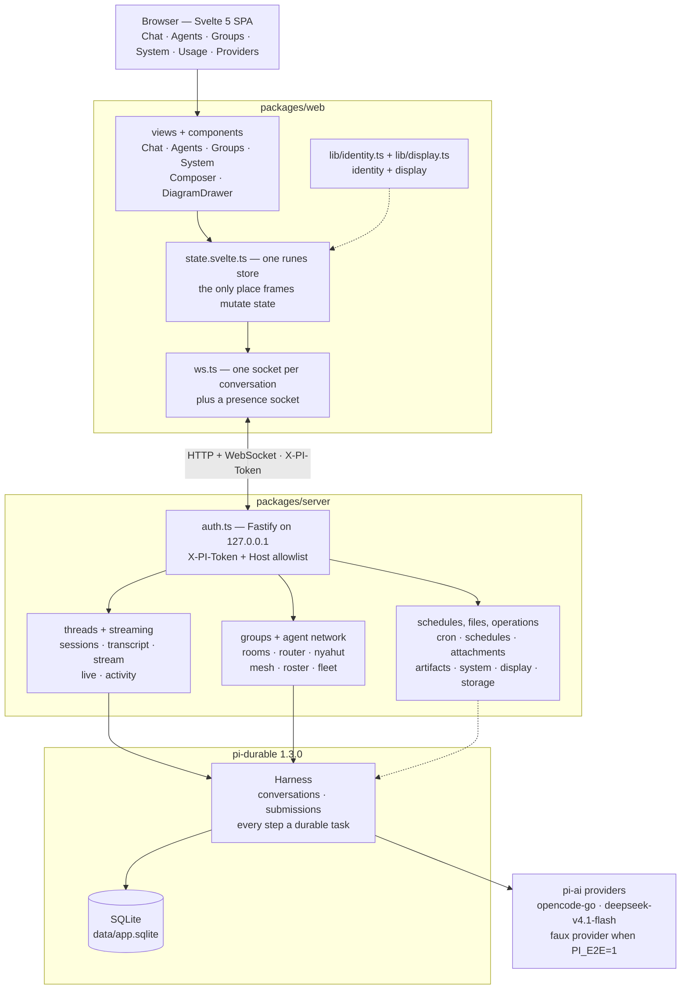

# Agent Chats That Survive a Crash

> A local agent chat where closing the browser, killing the server, or losing the
> network costs you nothing: every message, tool call and generation is a durable
> task in SQLite. Agents can also message each other, run on schedules, and produce
> files you can download.

| | |
| --- | --- |
| **Repository** | [github.com/mariobgsp/durable-agents](https://github.com/mariobgsp/durable-agents) |
| **Role** | TypeScript / full-stack engineering, durable execution, streaming protocol design |
| **Stack** | Svelte 5 (runes) + Vite 8 · Fastify + WebSocket · SQLite via `@earendil-works/pi-durable` 1.3.0 |
| **Verified** | Re-read against `06f5bad` (2026-10-25). Checks are the repository's 2026-10-24 run; screenshots are from 2026-10-19. |
| **Order** | 2 |

## At a glance

- **What it is** — a single-user web app for durable agent work: threads that
  survive restarts, agents defined by two markdown files, group chats, a directed
  agent network, schedules, generated files, and a system panel.
- **Who it's for** — anyone who treats an agent session as work rather than a
  prompt: long threads, expensive generations, and a strong preference not to lose
  either because a socket dropped.
- **The interesting part** — durability is not a save button. It is a **durable
  task log**. The harness owns progress, and the UI's job is to render what the log
  says, including re-attaching to a generation that was already running when you
  left.

## The problem

Conventional chat UIs model a conversation as client state. That assumption breaks
once each turn costs real money and takes minutes.

- **A dropped socket loses the answer.** The generation completes upstream, but
  nothing in the browser owns it, so the reply never lands.
- **A reload forgets what was happening.** There is no record that a turn was in
  flight, so a resume means re-asking and re-paying.
- **"Still working?" has no answer.** A spinner cannot distinguish a slow
  generation from a dead one, and in a group chat it cannot say *which* agent is
  mid-sentence.

This project inverts the ownership: the harness writes durable tasks first, and the
browser is a view onto that log.

## What it does

| Capability | How |
| --- | --- |
| **Durable threads** | Every message, tool call and generation is a durable task. `resume()` replays work that was interrupted. |
| **Live streaming** | A WebSocket per conversation emits `snapshot → entry → message-start → delta… → message-end`. Reconnecting re-reads the log rather than restarting the answer. |
| **Agents as files** | `data/agents/<slug>/{agent.json,AGENT.md,SOUL.md}`. `SOUL.md` is who the agent is; `AGENT.md` is its working rules. Saving rebinds the files into live threads. |
| **Group chat** | Three modes: `Nyahut` (agents claim a message by responsibility), `Moderator` (one designated member), and `Silent` (`@mention` only). |
| **Agent network** | `agents_message` delivers to one directed inbox thread per sender–recipient pair; fan-out reaches 16 targets. `agents_delegate` creates one task thread per target. Calls are idempotent by request id, with a 6-hop guard. |
| **Fleet and activity** | One snapshot of which agents are working, idle or disabled, their thread, token totals and live links, pushed over the presence socket. |
| **Schedules** | A per-agent 5-field cron owns one thread: run-now, skip-when-busy, restart-safe; a missed window is counted, not replayed. |
| **Files and output** | Attachments live in the message entry the model was given. Agents can write Markdown, text, JSON, PDF or published files as download cards under `data/artifacts`. |
| **Operations** | `#/system` reports versions, sandbox and supervisor, with Update and Restart. `#/usage` covers storage, cleanup and spend. Agents customise a closed display token set, never the source. |

## How it works


<details>
<summary>Mermaid source (<code>diagrams/durable-agents.mmd</code>)</summary>



</details>

### Components

- **`packages/server/src/index.ts`** — every REST route and the WebSocket
  upgrade, plus the boot-time activity scan. The message route allows a 24 MiB
  body because a message carries its attachments.
- **`sessions.ts`, `transcript.ts`, `stream.ts`, `live.ts`** — the thread
  index, durable entries to wire messages, `watch()` to frames, and the one reader
  of `pi.live` that derives the activity phase, calls and elapsed time.
- **`rooms.ts`, `router.ts`, `nyahut.ts`** — group orchestration.
  `planTargets()` is pure: no network, no model, no file access, so routing is
  testable in isolation.
- **`mesh.ts`, `mesh-tools.ts`, `roster.ts`, `fleet.ts`** — directed
  inbox/task threads, fan-out, the link index, the hop guard, and the fleet
  snapshot.
- **`cron.ts`, `schedules.ts`** — the cron parser, the per-agent schedule store,
  and the 15-second tick that skips a busy thread and records duration and tokens.
- **`artifacts.ts`, `attachments.ts`, `documents.ts`** — generated files,
  image normalisation, and bytes-to-text. Attachments live in the entry the model
  read; artifacts are indexed by their entry.

### One message, end to end

1. You press Enter. The store sets `busy` immediately, so the input feels instant
   while nothing has been sent.
2. `POST /api/sessions/:id/messages` validates and converts the message (shape,
   budget, image policy, documents), then submits an `input` event. It is already
   durable when the submission id comes back; a refusal throws before anything is
   written, so the draft is intact.
3. The server marks the session active and broadcasts presence, so every other tab
   learns this thread is generating.
4. The browser opens or reuses the conversation socket. The harness starts the
   generation, and the server reads partials out of the durable `pi.live`
   document and emits the suffix as `delta` frames — roughly 80 ms apart.
5. On completion the committed entry is emitted as `entry`, the bubble closes
   with `message-end`, and `waitForIdle()` resolves so the session is idle again.

## Key choices

| Choice | Why | Cost |
| --- | --- | --- |
| **Durability belongs to the harness** | `resume()` replays interrupted work, so "reload during a long generation" is a supported path, not data loss. | The UI must handle snapshots, re-attachment and out-of-order resumption. |
| **Streaming reads `pi.live`** | The provider never emits `message_update`, so the server reads the message in flight and emits the difference. | An internal shape is load-bearing; the clean fix belongs upstream. |
| **Pure group routing + idempotent mesh calls** | `planTargets()` is testable without I/O, and every mesh call reuses its request id, so a replay after a crash does not duplicate a thread. | The claim round adds latency, and fan-out is capped by hops and targets. |
| **Schedules are restart-safe** | A schedule owns one thread, a due minute gets one request id, and a busy thread is skipped. | Cron uses the server's local time and has no backfill. |
| **A real local security boundary** | Loopback bind, `X-PI-Token`, Host allowlist, no permissive CORS, and a Standard / Custom / Full Access tier enforced at tool-call time. | You must inject the token, and Full Access is a deliberate per-thread grant. |

## Running it

```bash
git clone https://github.com/mariobgsp/durable-agents && cd durable-agents
npm install
npm run dev            # creates data/token (600), Fastify on 8787, Vite on 5173
# open http://localhost:5173

npm run build && npm start   # one process serving UI + API + WS on 8787

npm run check          # tsc + svelte-check + the language lint
npm run e2e            # 21 deterministic scenarios, faux provider
npm run shots          # routes x 5 viewports -> docs/ui-review/<date>/
npm run seed           # demo threads, no model calls
```

Credentials resolve in this order: `~/.pi/agent/auth.json` →
`OPENCODE_API_KEY` → `data/credentials.json` (written by the `#/providers`
screen).

### What I observed

These are the repository's latest verified numbers, not a fresh run:

| Check | Result |
| --- | --- |
| `npm run check` | `tsc` clean; `svelte-check` 0 errors, 2 warnings in `Dialog.svelte`; `lint:lang` clean |
| `npm run e2e` | 21 passed, 0 failed — including `mesh`, `fleet`, `schedules`, `files`, `system`, `display` and `usage` |
| `npm run build` | entry 89.1 kB JS + 10.9 kB CSS gzip; mermaid and `elk` stay in their own lazy chunks |

The E2E suite asserts the design, not the implementation: an idle thread stays
idle **after a restart**, a grant is enforced at submit time and not sticky on the
agent, a purge removes rows from `entries`, and a schedule skips a busy thread.

## Screenshots


*The agent list. Each card carries its identity, its one-line responsibility, and
its model.*


*Editing an agent means editing two markdown files, plus its identity and model.*


*A group thread in `Nyahut` mode. The system notes show the claim pass resolving a
question to the agent whose responsibility covers it.*

## What I'd fix next

- **A purge has no UI.** `POST /api/sessions/:id/purge` exports the transcript and
  deletes the rows, but the Storage panel only states what it would do; the thread
  menu's delete stays a soft delete.
- **Notifications need the tab open.** The page can notify while hidden or on
  another thread; a browser fully closed needs push infrastructure that is not
  implemented.
- **Generated files are download-only.** There is no inline PDF preview and no
  zip-all. The built-in PDF writer uses base fonts, so non-Latin glyphs become
  "?".
- **Cron has no backfill and schedules are owner-managed.** A window missed while
  the server was off is counted as missed, not replayed, and no agent-facing tool
  can create or cancel a schedule yet.

## Links

- **Source:** [github.com/mariobgsp/durable-agents](https://github.com/mariobgsp/durable-agents)
- **Harness:** [`@earendil-works/pi-durable`](https://www.npmjs.com/package/@earendil-works/pi-durable) (pinned 1.3.0)
- **Plan of record:** [`docs/roadmap.md`](https://github.com/mariobgsp/durable-agents/blob/main/docs/roadmap.md)
- **Agent network design:** [`docs/design/agent-mesh.md`](https://github.com/mariobgsp/durable-agents/blob/main/docs/design/agent-mesh.md)
- **System and display:** [`docs/design/system-and-display.md`](https://github.com/mariobgsp/durable-agents/blob/main/docs/design/system-and-display.md)
- **The boundary:** [`deploy/dura-agents.service`](https://github.com/mariobgsp/durable-agents/blob/main/deploy/dura-agents.service)

---

*Verified against commit `06f5bad` (2026-10-25). Diagram source:
[`diagrams/durable-agents.mmd`](diagrams/durable-agents.mmd). Capture script:
[`tools/capture/durable-agents.mjs`](tools/capture/durable-agents.mjs).*
