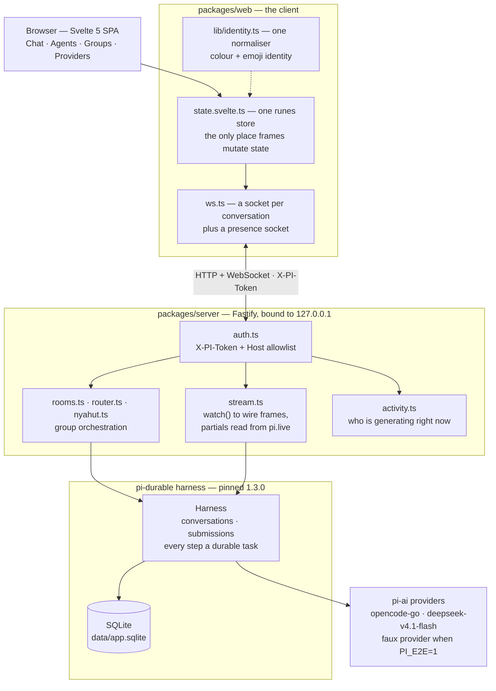
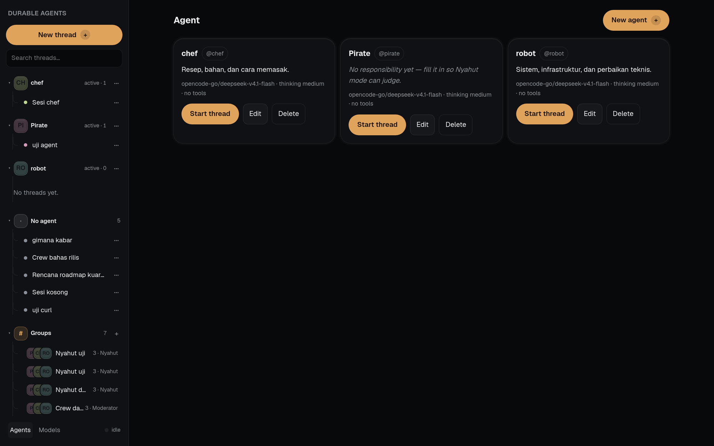
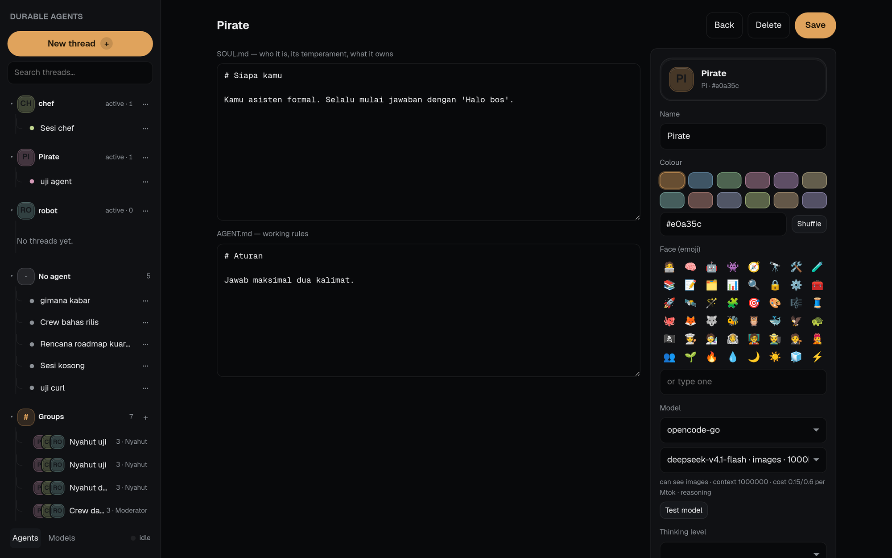
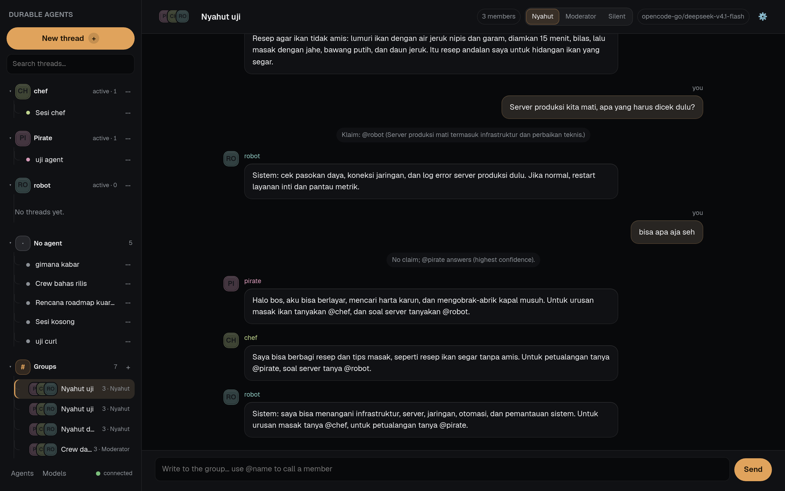

# Chats That Survive a Crash: Durable Agent Conversations on a SQLite Task Log

> A local agent chat where closing the browser, killing the server, or losing the
> network costs you nothing: every message, tool call and generation is a durable
> task in SQLite, so the work in flight is still there when you come back. Agents
> are two markdown files, and groups of them talk to each other on their own.

| | |
| --- | --- |
| **Repository** | [github.com/mariobgsp/durable-agents](https://github.com/mariobgsp/durable-agents) |
| **Role** | TypeScript / full-stack engineering, durable execution, streaming protocol design |
| **Stack** | Svelte 5 (runes) + Vite 8 · Fastify + WebSocket · SQLite via `@earendil-works/pi-durable` 1.3.0 |
| **Verified** | App run locally, checks and E2E suite executed (2026-10-17). Verification numbers below are mine, not quoted from the README. |

## At a glance

- **What it is** — a single-user web app for talking to AI agents: threads that
  survive restarts, agents defined by `AGENT.md` + `SOUL.md`, and group chats
  where several agents decide among themselves who answers.
- **Who it's for** — anyone who treats an agent session as work rather than a
  prompt: long threads, expensive generations, and a strong preference not to lose
  either because a socket dropped.
- **The interesting part** — the durability is not a save button. It is a
  **durable task log**: the harness owns progress, and the UI's job reduces to
  *rendering what the log says*, including re-attaching to a generation that was
  already running when you left.

## The problem: agent chat is the least durable part of the stack

Conventional chat UIs model a conversation as client state. That assumption breaks
badly once each turn costs real money and takes minutes:

- **A dropped socket loses the answer.** The generation completes upstream, but
  nothing in the browser owns it, so the reply never lands.
- **A reload forgets what was happening.** There is no record that a turn was in
  flight, so a resume means re-asking and re-paying.
- **"Still working?" has no answer.** A spinner is a guess; it cannot distinguish
  a slow generation from a dead one, and in a group chat it cannot say *which*
  agent is mid-sentence.

This project inverts the ownership: the harness writes durable tasks first, and the
browser is a view onto that log.

## What it does

| Capability | How |
| --- | --- |
| **Durable threads** | Every message, tool call and generation is a durable task; `resume()` replays work that was interrupted. |
| **Live streaming** | Per-conversation WebSocket emitting `snapshot` → `entry` → `message-start` → `delta`… → `message-end`. |
| **Agents as files** | `data/agents/<slug>/{agent.json,AGENT.md,SOUL.md}`. `SOUL.md` is who it is; `AGENT.md` is its working rules. |
| **Hot reload into live threads** | Saving an agent rebinds it into existing threads (`rebindAgent`) and reports how many threads took the new files. |
| **Group chat, three modes** | `Nyahut` (agents claim a message by responsibility), `Moderator` (one designated member), `Silent` (`@mention` only). |
| **Live presence** | A presence socket says which sessions are generating, including ones you are not looking at. |
| **Per-agent models** | Each agent picks its own provider and model, with capability badges (image input, context window, cost, thinking levels). |
| **One identity system** | Colour + emoji per agent and per group, normalised in a single module. |

## Why this stack

| Layer | Choice | Why this — and not the obvious alternative |
| --- | --- | --- |
| Durability | **`pi-durable` on SQLite** | Durability is a property of the substrate, not of the UI. A single SQLite file in WAL mode means an interrupted generation is *resumable by construction*, with no queue, no worker fleet and no server-side session memory to rebuild. |
| Backend | **Fastify, bound to `127.0.0.1`** | The server proxies model calls and reads agent files off disk; a small, explicit HTTP layer with a WebSocket upgrade is the whole surface. |
| Frontend | **Svelte 5 with runes** | Chat is a long-lived stream of small mutations. Runes give fine-grained reactivity without a virtual DOM or a state library, and the whole client ships at **58.77 kB gzip**. |
| Transport | **WebSocket with an explicit frame contract** | Streaming partials need push, not polling. The frame types are declared in `wire.ts` on the server and mirrored in `ws.ts` on the client, so the contract has exactly two files to check. |
| State | **One runes store** | `state.svelte.ts` is the only place incoming frames mutate state. One writer makes "why does the sidebar disagree with the chat header" a non-question — a bug class this project explicitly tested for. |
| Testing | **E2E only, against a faux provider** | With `PI_E2E=1` every real provider is swapped for the harness's faux provider, making the whole stack deterministic: no network, no cost, no flakes. |
| Bundle | **A 100 kB gzip budget** | A local app still has to load before it feels local. The budget turns "add a dependency" into a deliberate decision. |

## Architecture


<details>
<summary>Mermaid source (<code>diagrams/durable-agents.mmd</code>)</summary>



</details>

### Component walkthrough

- **`packages/server/src/sessions.ts`** — the session index (`data/sessions.json`),
  transcripts, `sendMessage` and `rebindAgent`.
- **`packages/server/src/stream.ts`** — turns `conversation.watch()` into wire
  frames, reading partials out of the durable `pi.live` document.
- **`packages/server/src/router.ts`** — `planTargets()`, a **pure** function that
  decides who answers one message. No network, no model, no file access, so group
  routing is testable without any of the machinery around it.
- **`packages/server/src/nyahut.ts`** — the claim and oversee passes as short,
  stateless calls.
- **`packages/server/src/activity.ts`** — an in-memory registry of which sessions
  are generating, pushed over the presence socket instead of polled.
- **`packages/web/src/state.svelte.ts`** — the single store; the only place frames
  mutate state.
- **`packages/web/src/lib/identity.ts`** — one normaliser for agent and group
  identity, so the sidebar, chat header and message bubbles cannot disagree.

### One message, end to end

1. You press Enter. The store sets `busy` immediately, so the input feels
   instant while nothing has been sent.
2. `POST /api/sessions/:id/messages` submits an `input` event to the harness. It is
   **already durable** when the submission id comes back.
3. The server marks the session active and opens a presence broadcast, so every
   *other* tab learns this thread is generating.
4. The browser opens (or reuses) that conversation's socket; the harness starts the
   generation.
5. Partials are read out of the durable `pi.live` document and diffed, and the
   suffix is emitted as `delta` frames — roughly 80 ms apart in a real session.
6. On completion the committed entry is emitted as `entry`, the bubble closes with
   `message-end`, and `waitForIdle()` resolves so the session is marked idle again.

## Architecture decisions worth defending

**Durability belongs to the harness, not the UI.**
*Decision:* progress lives in durable tasks in SQLite; the browser renders what the
log says. *Cost:* the UI has to handle snapshots, re-attachment and out-of-order
resumption rather than just appending to an array. *Benefit:* `resume()` replays
interrupted work, so "reload during a long generation" is a supported path instead
of a data-loss path.

**Streaming reads the live document, because the provider does not emit updates.**
The repo states the reason without dressing it up: `message_update` is never emitted
by `watchEvents` for its default provider, so translated view changes never arrive
as partials. The server therefore reads the assistant message in flight directly
out of the `pi.live` document and emits the *difference*:

```text
snapshot  { entries: [...] }      # durable transcript so far
entry     { role: "user" }        # the message you just sent
message-start                     # a bubble opens
delta     { text: "Ahoy, " }
delta     { text: "I am the " }
entry     { role: "assistant" }   # the committed entry
message-end
```

*Cost:* an undocumented internal shape is now load-bearing, which is a real
coupling to pay down. *Benefit:* live streaming works today, and the fallback
degrades safely — only `pi.assistant` entries may close a bubble, so the start/end
events that *do* fire for user entries cannot truncate an answer.

**Presence is pushed, and cleared with an epoch guard.**
The server tracks generating sessions in memory and pushes changes, using the
harness's own `waitForIdle()` rather than polling or scanning transcripts. The clear
is epoch-guarded so a waiter that resolves late cannot wipe the mark of a generation
that started in between, and a 10-minute watchdog stops a hung provider from pinning
a spinner forever. *Cost:* a second socket and a little server state. *Benefit:*
"who is replying" is correct across tabs, and a stuck provider becomes an idle
thread instead of a permanent lie.

**Group routing is a pure function; claiming is a separate, cheaper call.**
`planTargets()` decides `@mention` precedence and mode behaviour with no I/O, and
`Nyahut` mode runs *claim* as a short stateless call per member before anyone
answers. A user message therefore costs roughly `2N − R` short calls plus `R` full
ones (`N` members, `R` responders) — an explicit cost model rather than an emergent
one. *Cost:* the claim round adds latency to a group message. *Benefit:* the wrong
agent does not spend a full generation on a message it has no business answering, and
`one agent answers once per user message` is a rule, not a hope.

**Identity has exactly one normaliser.**
Colour and emoji are resolved in `lib/identity.ts` for agents, groups and members.
*Cost:* one more indirection when adding an identity field. *Benefit:* the same
agent cannot show one colour in the sidebar and another in the bubble — and the E2E
suite tests precisely that: a patch touching an unrelated field must not disturb
identity, across a restart.

**The app that runs `bash` gets a real security boundary.**
The server binds `127.0.0.1`, rejects any request without `X-PI-Token`, allowlists
`Host`, ships no permissive CORS, and stores its 32-byte token with mode `600`.
*Cost:* you must inject the token into the page (the dev script does it for you).
*Benefit:* a foreign web page can neither read the app nor reach an API that runs
commands — which matters a great deal for a tool whose `bash` tool is genuine code
execution, and which the editor warns about.

**E2E instead of unit tests, deliberately.**
*Decision:* no unit tests; four E2E scenarios each boot a throwaway server with its
own port, data directory and token, against the faux provider. *Cost:* coarser
failure localisation and slower feedback than a unit suite. *Benefit:* the thing
under test is the real assembly — real sockets, real SQLite, real streaming — and it
is deterministic. It has already earned its keep: the suite caught that an
instant answer never streamed (the faux provider now streams at 12 tokens/second)
and that announcing `content-type: application/json` on an empty body makes Fastify
answer 400 — which made `DELETE` look broken.

## Running it

```bash
git clone https://github.com/mariobgsp/durable-agents && cd durable-agents
npm install
npm run dev            # creates data/token (600), Fastify on 8787, Vite on 5173
# → http://localhost:5173

npm run build && npm start   # one process serving UI + API + WS on 8787

# checks
npm run check          # tsc + svelte-check + the language lint
npm run e2e            # four deterministic scenarios, faux provider
npm run shots          # 8 routes × 5 viewports → docs/ui-review/<date>/
npm run seed           # demo threads, no model calls
```

Credentials resolve in this order: `~/.pi/agent/auth.json` →
`OPENCODE_API_KEY` → `data/credentials.json` (written by the `#/providers` screen).

### What I observed

I ran the project's own gates rather than trusting the status table:

| Check | My result |
| --- | --- |
| `npm run check` | `svelte-check` **0 errors**, 2 warnings in 1 file; `tsc` clean; `check-language: clean` |
| `npm run e2e` | **4 passed, 0 failed** (`activity`, `identity`, `models`, `sessions`) |
| `npm run build` | `index.js` **58.77 kB gzip**, `index.css` **5.75 kB gzip** — inside the 100 kB budget |

The E2E suite is the part worth dwelling on, because it asserts the design rather
than the implementation. `identity` checks that an agent's colour and emoji survive
a later patch that touches an unrelated field — the exact bug class the single
normaliser exists to prevent. `activity` checks that an idle thread is *still* not
active **after a restart**, which is what makes the presence registry trustworthy
rather than merely optimistic.

## Screenshots



*The agent list. Each card carries its identity (avatar, colour, `@handle`), its
one-line `responsibility`, and its model. Note `Pirate`: "No responsibility yet —
fill it in so Nyahut mode can judge." That single field is what the group claim pass
reads, and the UI says so instead of letting an unprotected group fail silently.*



*Editing an agent is editing two markdown files: `SOUL.md` ("who it is, its
temperament, what it owns") and `AGENT.md` ("working rules"). The right column is the
identity and model panel — the palette and emoji grid that feed the single
normaliser, and a model picker that reports the selected model's real capabilities
(image input, a 1,000k context window, cost per Mtok, reasoning).*



*A group thread in `Nyahut` mode. The system notes are the visible part of the
protocol: `Klaim: @robot (…)` shows the claim pass resolving a question to the agent
whose stated responsibility covers it, and `No claim; @pirate answers (highest
confidence)` shows the fallback when nobody claims. The mode switch (`Nyahut` /
`Moderator` / `Silent`) is per-group, the sidebar shows member avatars and which
threads are active, and the presence socket reports `connected`.*

## What I'd fix next

The repository's own gap list is unusually specific, and it is accurate — worth
repeating rather than rediscovering, in the order I would take them:

- **Attachments do not exist.** No image or file input in the composer yet, despite
  the model capability catalog already tracking which models can see images.
- **The Tauri desktop shell has never been compiled** (`tauri-plugin-single-instance`
  is not installed), so running the desktop app twice would point two servers at one
  `app.sqlite`.
- **No system notifications** on turn completion, and no real cost counter — the
  group cost model is an estimate shown in a tooltip.
- **The streaming workaround is a coupling to pay down.** Reading partials from the
  `pi.live` document works, but it depends on an internal shape; the clean fix is on
  the provider/harness side, where `message_update` should be emitted.
- **Single-user by design.** No remote deploy, no billing, no multi-user.

## Links

- **Source:** [github.com/mariobgsp/durable-agents](https://github.com/mariobgsp/durable-agents)
- **Harness:** [`@earendil-works/pi-durable`](https://www.npmjs.com/package/@earendil-works/pi-durable) (pinned 1.3.0)
- **Plan of record:** [`docs/roadmap.md`](https://github.com/mariobgsp/durable-agents/blob/main/docs/roadmap.md)
- **UI review gallery:** [`docs/ui-review/`](https://github.com/mariobgsp/durable-agents/tree/main/docs/ui-review)

---

*Verified against commit `19256b7` (README uses an English example transcript).
Diagram source: [`diagrams/durable-agents.mmd`](diagrams/durable-agents.mmd).
Capture script: [`tools/capture/durable-agents.mjs`](tools/capture/durable-agents.mjs).*
