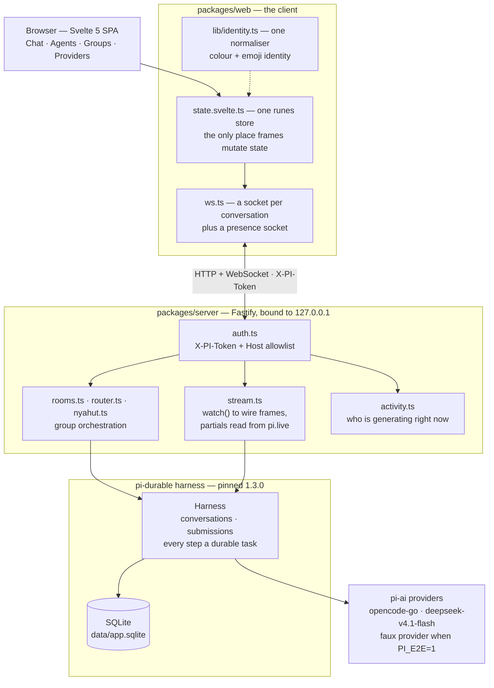

# Chats That Survive a Crash: Durable Agent Conversations on a SQLite Task Log

> A local agent chat where closing the browser, killing the server, or losing the
> network costs you nothing: every message, tool call and generation is a durable
> task in SQLite, so the work in flight is still there when you come back. Agents
> are two markdown files, and groups of them talk to each other on their own.

| | |
| --- | --- |
| **Repository** | [github.com/mariobgsp/durable-agents](https://github.com/mariobgsp/durable-agents) |
| **Role** | TypeScript / full-stack engineering, durable execution, streaming protocol design |
| **Stack** | Svelte 5 (runes) + Vite 8 · Fastify + WebSocket · SQLite via `@earendil-works/pi-durable` 1.3.0 |
| **Verified** | App run locally, checks and E2E suite executed (2026-10-19). Verification numbers below are mine, not quoted from the README. |
| **Order** | 2 |

## At a glance

- **What it is** — a single-user web app for talking to AI agents: threads that
  survive restarts, agents defined by `AGENT.md` + `SOUL.md`, and group chats
  where several agents decide among themselves who answers.
- **Who it's for** — anyone who treats an agent session as work rather than a
  prompt: long threads, expensive generations, and a strong preference not to lose
  either because a socket dropped.
- **The interesting part** — the durability is not a save button. It is a
  **durable task log**: the harness owns progress, and the UI's job reduces to
  *rendering what the log says*, including re-attaching to a generation that was
  already running when you left.

## The problem: agent chat is the least durable part of the stack

Conventional chat UIs model a conversation as client state. That assumption breaks
badly once each turn costs real money and takes minutes:

- **A dropped socket loses the answer.** The generation completes upstream, but
  nothing in the browser owns it, so the reply never lands.
- **A reload forgets what was happening.** There is no record that a turn was in
  flight, so a resume means re-asking and re-paying.
- **"Still working?" has no answer.** A spinner is a guess; it cannot distinguish
  a slow generation from a dead one, and in a group chat it cannot say *which*
  agent is mid-sentence.

This project inverts the ownership: the harness writes durable tasks first, and the
browser is a view onto that log.

## What it does

| Capability | How |
| --- | --- |
| **Durable threads** | Every message, tool call and generation is a durable task; `resume()` replays work that was interrupted. |
| **Live streaming** | Per-conversation WebSocket emitting `snapshot` → `entry` → `message-start` → `delta`… → `message-end`. |
| **Agents as files** | `data/agents/<slug>/{agent.json,AGENT.md,SOUL.md}`. `SOUL.md` is who it is; `AGENT.md` is its working rules. |
| **Hot reload into live threads** | Saving an agent rebinds it into existing threads (`rebindAgent`) and reports how many threads took the new files. |
| **Group chat, three modes** | `Nyahut` (agents claim a message by responsibility), `Moderator` (one designated member), `Silent` (`@mention` only). |
| **Live presence and activity** | A presence socket says which sessions are generating, including ones you are not looking at; the active thread gets the phase, the calls and the elapsed time derived from `pi.live`. |
| **Per-agent models** | Each agent picks its own provider and model, with capability badges (image input, context window, cost, thinking levels). |
| **One identity system** | Colour + emoji per agent and per group, normalised in a single module. |
| **Attachments** | Images are normalized server-side to the model's own limits and documents become text; the bytes live in the entry the model was given, so there is no upload store. |
| **Full Access per thread** | An agent has a Standard / Custom / Full Access tier; a grant lifts one thread to Full Access, is enforced at tool-call time, and dies with that thread. |
| **Storage you can measure** | `#/usage` splits the data directory by part; cleanup returns the bytes it actually gave back; a purge exports the transcript before deleting its rows. |
| **Ask, and search without a key** | A `question` tool writes a durable `chat.question` entry with option buttons; `web-search` reads DuckDuckGo's keyless HTML endpoint. |
| **Links and diagrams** | External links are re-targeted after sanitizing; a fenced `mermaid` block becomes a pan/zoom component whose library is fetched only when a diagram renders. |

## Why this stack

| Layer | Choice | Why this — and not the obvious alternative |
| --- | --- | --- |
| Durability | **`pi-durable` on SQLite** | Durability is a property of the substrate, not of the UI. A single SQLite file in WAL mode means an interrupted generation is *resumable by construction*, with no queue, no worker fleet and no server-side session memory to rebuild. |
| Backend | **Fastify, bound to `127.0.0.1`** | The server proxies model calls and reads agent files off disk; a small, explicit HTTP layer with a WebSocket upgrade is the whole surface. |
| Frontend | **Svelte 5 with runes** | Chat is a long-lived stream of small mutations. Runes give fine-grained reactivity without a virtual DOM or a state library, and the entry ships at **71.86 kB gzip**, with mermaid and its layout engines in their own chunks. |
| Transport | **WebSocket with an explicit frame contract** | Streaming partials need push, not polling. The frame types are declared in `wire.ts` on the server and mirrored in `ws.ts` on the client, so the contract has exactly two files to check. |
| State | **One runes store** | `state.svelte.ts` is the only place incoming frames mutate state. One writer makes "why does the sidebar disagree with the chat header" a non-question — a bug class this project explicitly tested for. |
| Testing | **E2E only, against a faux provider** | With `PI_E2E=1` every real provider is swapped for the harness's faux provider, and thirteen scenarios each boot a throwaway server: no network, no cost, no flakes. |
| Bundle | **A 100 kB gzip budget** | A local app still has to load before it feels local. The budget turns "add a dependency" into a deliberate decision. |

## Architecture


<details>
<summary>Mermaid source (<code>diagrams/durable-agents.mmd</code>)</summary>



</details>

### Component walkthrough

- **`packages/server/src/index.ts`** — every REST route and the WebSocket upgrade,
  plus the boot-time activity scan. The message route declares its own 24 MiB body
  limit because one request carries its own attachments.
- **`packages/server/src/sessions.ts`** — the session index (`data/sessions.json`),
  the thread's own `grant`, `sendMessage` and `rebindAgent`.
- **`packages/server/src/transcript.ts`** — turns durable entries into wire messages.
  A user message is read through its own `chat.user` record, so attachment refs and a
  `chat.question` entry need no special case in the mapper.
- **`packages/server/src/stream.ts`** — turns `conversation.watch()` into wire
  frames, reading partials out of the durable `pi.live` document.
- **`packages/server/src/live.ts`** — the one reader of `pi.live` and `pi.inbox`: it
  derives the activity phase, the calls of the round, the queued inputs and the typing
  authors. The phase is observed, never timed.
- **`packages/server/src/attachments.ts`** — the only module that knows how a file
  becomes a message: validate, normalize an image to the model's own limits, convert a
  document, and record the result in the entry's own `data.files[]`.
- **`packages/server/src/documents.ts`** — bytes to text: UTF-8 detected by decoding,
  PDF through `pdftotext` on **stdin**, never a path, and a stable reason when there is
  no text to send.
- **`packages/server/src/permissions.ts`** — the policy behind Standard / Custom / Full
  Access: it refuses `bash` and `codemode` to Standard and checks `read`/`write`/`edit`
  paths against the agent's roots. The per-thread grant is resolved here; the systemd
  unit is the boundary that actually contains an allowed tool.
- **`packages/server/src/storage.ts`** — the data directory by part, the checkpoint +
  vacuum, and the purge that writes `data/exports/<id>.json` before it deletes a row.
- **`packages/server/src/usage.ts`** — the aggregates behind the Usage screen, read
  from the durable log rather than a second counter.
- **`packages/server/src/questions.ts`** — the `question` tool: it writes a durable
  `chat.question` entry with `data.options` and ends the turn.
- **`packages/server/src/search.ts`** — the `web-search` tool over DuckDuckGo's keyless
  HTML endpoint; a changed page or an HTTP failure is reported as a failure, never as
  "no results".
- **`packages/server/src/router.ts`** — `planTargets()`, a **pure** function that
  decides who answers one message. No network, no model, no file access, so group
  routing is testable without any of the machinery around it.
- **`packages/server/src/nyahut.ts`** — the claim and oversee passes as short,
  stateless calls.
- **`packages/server/src/activity.ts`** — an in-memory registry of which sessions
  are generating, pushed over the presence socket instead of polled.
- **`packages/web/src/state.svelte.ts`** — the single store; the only place frames
  mutate state.
- **`packages/web/src/lib/markdown.ts`** — markdown to sanitized HTML: mermaid fences
  become their own component, and the external-link policy is installed after
  sanitizing, so raw HTML in a message goes through the same rule.
- **`packages/web/src/lib/identity.ts`** — one normaliser for agent and group
  identity, so the sidebar, chat header and message bubbles cannot disagree.
- **The web components** — `Attachments.svelte` renders a message's files and the
  server's reason when one was not sent; `QuestionOptions.svelte` draws a question's
  buttons, answerable once; `Mermaid.svelte` imports mermaid inside its render effect
  with `securityLevel: "strict"` and pans/zooms with transform math;
  `ActivityIndicator.svelte` and `ActivityStrip.svelte` draw the phase, the calls and
  the durable elapsed time; `Usage.svelte` holds the usage graphs and the Storage panel.

### One message, end to end

1. You press Enter. The store sets `busy` immediately, so the input feels
   instant while nothing has been sent.
2. `POST /api/sessions/:id/messages` validates and converts the message (attachments,
   the agent's image policy) and then submits an `input` event to the harness. It is
   **already durable** when the submission id comes back; a refusal throws before
   anything is written, so the draft is intact.
3. The server marks the session active and opens a presence broadcast, so every
   *other* tab learns this thread is generating.
4. The browser opens (or reuses) that conversation's socket; the harness starts the
   generation.
5. Partials are read out of the durable `pi.live` document and diffed, and the
   suffix is emitted as `delta` frames — roughly 80 ms apart in a real session.
6. On completion the committed entry is emitted as `entry`, the bubble closes with
   `message-end`, and `waitForIdle()` resolves so the session is marked idle again.

### The HTTP surface

The routes are the whole API; everything else is a socket frame or a file on disk.

| Area | Routes |
| --- | --- |
| Liveness | `GET /api/health` |
| Threads | `GET/POST /api/sessions` · `PATCH/DELETE /api/sessions/:id` · `POST /api/sessions/:id/{restore,move,restart,abort}` |
| Messages | `GET/POST /api/sessions/:id/messages` · `GET /api/sessions/:id/attachments/:entryId/:index` |
| Context and model | `GET /api/sessions/:id/context` · `POST /api/sessions/:id/compact` · `PUT /api/sessions/:id/model` |
| Permissions and storage | `POST /api/sessions/:id/permissions` · `GET /api/storage` · `POST /api/storage/cleanup` · `POST /api/sessions/:id/purge` |
| Agents | `GET/POST /api/agents` · `GET/PUT/DELETE /api/agents/:id` · `POST /api/agents/:id/enabled` · `POST /api/agents/suggest-responsibility` |
| Models, activity, usage | `GET /api/models` · `POST /api/models/test` · `GET /api/activity` · `GET /api/usage` |
| Providers | `GET /api/providers` · `PUT/DELETE /api/providers/:id/key` |
| Groups | `POST /api/rooms` · `PUT /api/rooms/:id` |
| Sockets | `GET /api/ws?conversation=<id>` · `GET /api/ws/presence` |
| E2E only | `GET/POST /api/e2e/{state,script}` when `PI_E2E=1` and the token is right |

## Architecture decisions worth defending

**Durability belongs to the harness, not the UI.**
*Decision:* progress lives in durable tasks in SQLite; the browser renders what the
log says. *Cost:* the UI has to handle snapshots, re-attachment and out-of-order
resumption rather than just appending to an array. *Benefit:* `resume()` replays
interrupted work, so "reload during a long generation" is a supported path instead
of a data-loss path.

**Streaming reads the live document, because the provider does not emit updates.**
The repo states the reason without dressing it up: `message_update` is never emitted
by `watchEvents` for its default provider, so translated view changes never arrive
as partials. The server therefore reads the assistant message in flight directly
out of the `pi.live` document and emits the *difference*:

```text
snapshot  { entries: [...] }      # durable transcript so far
entry     { role: "user" }        # the message you just sent
message-start                     # a bubble opens
delta     { text: "Ahoy, " }
delta     { text: "I am the " }
entry     { role: "assistant" }   # the committed entry
message-end
```

*Cost:* an undocumented internal shape is now load-bearing, which is a real
coupling to pay down. *Benefit:* live streaming works today, and the fallback
degrades safely — only `pi.assistant` entries may close a bubble, so the start/end
events that *do* fire for user entries cannot truncate an answer.

**Presence and activity are pushed, never polled.**
The server tracks generating sessions in memory and pushes changes, using the
harness's own `waitForIdle()` rather than polling or scanning transcripts. The
thread's phase, the calls of the round and the elapsed time ride in the same snapshot,
derived from `pi.live` and the run task; there is deliberately no per-call timer,
because a call is already running on the first publish that mentions it. The clear is
epoch-guarded so a waiter that resolves late cannot wipe the mark of a generation that
started in between, and a 10-minute watchdog stops a hung provider from pinning a
spinner forever. *Cost:* a second socket and a little server state. *Benefit:* "who is
replying" is correct across tabs, the indicator cannot narrate a stage that did not
happen, and a stuck provider becomes an idle thread instead of a permanent lie.

**Group routing is a pure function; claiming is a separate, cheaper call.**
`planTargets()` decides `@mention` precedence and mode behaviour with no I/O, and
`Nyahut` mode runs *claim* as a short stateless call per member before anyone
answers. A user message therefore costs roughly `2N − R` short calls plus `R` full
ones (`N` members, `R` responders) — an explicit cost model rather than an emergent
one. *Cost:* the claim round adds latency to a group message. *Benefit:* the wrong
agent does not spend a full generation on a message it has no business answering, and
`one agent answers once per user message` is a rule, not a hope.

**Identity has exactly one normaliser.**
Colour and emoji are resolved in `lib/identity.ts` for agents, groups and members.
*Cost:* one more indirection when adding an identity field. *Benefit:* the same
agent cannot show one colour in the sidebar and another in the bubble — and the E2E
suite tests precisely that: a patch touching an unrelated field must not disturb
identity, across a restart.

**The app that runs `bash` gets a real security boundary, and a visible policy in front of it.**
The server binds `127.0.0.1`, rejects any request without `X-PI-Token`, allowlists
`Host`, ships no permissive CORS, and stores its 32-byte token with mode `600`. On
top of that, an agent's Standard / Custom / Full Access tier decides which tools
exist: Standard refuses `bash` and `codemode`, and a scoped agent's `read`, `write`
and `edit` stay inside its roots. Full Access can be granted to one thread, and only
that thread — the grant lives on the session record, not on the agent, so the next
thread starts back at the agent's tier. The tier is a policy and the UI labels it as
one; `deploy/dura-agents.service` is what actually contains an allowed tool. *Cost:*
you must inject the token into the page (the dev script does it for you), and a
per-thread grant is a deliberate click on each thread that needs it. *Benefit:* a
foreign web page can neither read the app nor reach an API that runs commands — which
matters a great deal for a tool whose `bash` tool is genuine code execution, and which
the editor warns about — and a permission decision cannot quietly outlive the thread
that needed it.

**E2E instead of unit tests, deliberately.**
*Decision:* no unit tests; thirteen E2E scenarios each boot a throwaway server with
its own port, data directory and token, against the faux provider. *Cost:* coarser
failure localisation and slower feedback than a unit suite. *Benefit:* the thing
under test is the real assembly — real sockets, real SQLite, real streaming — and it
is deterministic. It has already earned its keep: the suite caught that an
instant answer never streamed (the faux provider now streams at 12 tokens/second)
and that announcing `content-type: application/json` on an empty body makes Fastify
answer 400 — which made `DELETE` look broken.

## Running it

```bash
git clone https://github.com/mariobgsp/durable-agents && cd durable-agents
npm install
npm run dev            # creates data/token (600), Fastify on 8787, Vite on 5173
# → http://localhost:5173

npm run build && npm start   # one process serving UI + API + WS on 8787

# checks
npm run check          # tsc + svelte-check + the language lint
npm run e2e            # 13 deterministic scenarios, faux provider
npm run shots          # 8 routes × 5 viewports → docs/ui-review/<date>/
npm run shots:replying # the activity states, attachment cards and the Full Access chip
npm run seed           # demo threads, no model calls
```

Credentials resolve in this order: `~/.pi/agent/auth.json` →
`OPENCODE_API_KEY` → `data/credentials.json` (written by the `#/providers` screen).

### What I observed

I ran the project's own gates rather than trusting the status table:

| Check | My result |
| --- | --- |
| `npm run check` | `svelte-check` **0 errors**, 2 warnings in 1 file; `tsc` clean; `check-language: clean` |
| `npm run e2e` | **13 passed, 0 failed** (`activity`, `attachments`, `identity`, `live-activity`, `memory`, `models`, `permissions`, `questions`, `search`, `sessions`, `steering`, `storage`, `tools`) |
| `npm run build` | `index.js` **71.86 kB gzip**, `index.css` **7.70 kB gzip** — inside the 100 kB budget; mermaid and `elk` (455.84 kB gzip) stay in their own chunks |

The E2E suite is the part worth dwelling on, because it asserts the design rather
than the implementation. `identity` checks that an agent's colour and emoji survive
a later patch that touches an unrelated field — the exact bug class the single
normaliser exists to prevent. `activity` checks that an idle thread is *still* not
active **after a restart**, which is what makes the presence registry trustworthy
rather than merely optimistic. `storage` asserts the purge removed rows from the
`entries` table, not just the session list; `permissions` asserts a grant is enforced
at submit time and is not sticky on the agent; `questions` asserts the durable
`chat.question` and the answer arriving as the next user message.

## Screenshots


*The agent list. Each card carries its identity (avatar, colour, `@handle`), its
one-line `responsibility`, and its model. Note `Pirate`: "No responsibility yet —
fill it in so Nyahut mode can judge." That single field is what the group claim pass
reads, and the UI says so instead of letting an unprotected group fail silently.*


*Editing an agent is editing two markdown files: `SOUL.md` ("who it is, its
temperament, what it owns") and `AGENT.md` ("working rules"). The right column is the
identity and model panel — the palette and emoji grid that feed the single
normaliser, and a model picker that reports the selected model's real capabilities
(image input, a 1,000k context window, cost per Mtok, reasoning).*


*A group thread in `Nyahut` mode. The system notes are the visible part of the
protocol: `Klaim: @robot (…)` shows the claim pass resolving a question to the agent
whose stated responsibility covers it, and `No claim; @pirate answers (highest
confidence)` shows the fallback when nobody claims. The mode switch (`Nyahut` /
`Moderator` / `Silent`) is per-group, the sidebar shows member avatars and which
threads are active, and the presence socket reports `connected`.*

## What I'd fix next

The repository's own gap list is unusually specific, and it is accurate — worth
repeating rather than rediscovering, in the order I would take them:

- **A purge has no UI.** `POST /api/sessions/:id/purge` exports the transcript and
  deletes the rows, but the Storage panel only states what it would do; the thread
  menu's delete stays a soft delete.
- **The diagram is a large lazy download.** Mermaid and its layout engines are their
  own chunks (`elk` alone is 455.84 kB gzip), fetched on the first diagram a thread
  renders — the entry bundle is untouched, but the first diagram is not cheap.
- **Web search follows DuckDuckGo's HTML.** Keyless and dependency-free, but a shape
  dependency: a changed page is reported as a failure rather than "no results", and
  the `search` E2E asserts against a stubbed page.
- **Groups refuse attachments.** Each member conversation is its own model-visible
  entry, so supporting it would keep one copy of every byte per member.
- **There is no per-call elapsed time.** With parallel tool execution a call is
  already running on its first publish, so its start is not observable; the round's
  own elapsed time is real and is shown instead.
- **The streaming workaround is a coupling to pay down.** Reading partials from the
  `pi.live` document works, but it depends on an internal shape; the clean fix is on
  the provider/harness side, where `message_update` should be emitted.
- **The Tauri desktop shell has never been compiled** (`tauri-plugin-single-instance`
  is not installed), so running the desktop app twice would point two servers at one
  `app.sqlite`.
- **No system notifications** on turn completion, and no real cost counter — the
  group cost model is an estimate shown in a tooltip.
- **Single-user by design.** No remote deploy, no billing, no multi-user.

## Links

- **Source:** [github.com/mariobgsp/durable-agents](https://github.com/mariobgsp/durable-agents)
- **Harness:** [`@earendil-works/pi-durable`](https://www.npmjs.com/package/@earendil-works/pi-durable) (pinned 1.3.0)
- **Plan of record:** [`docs/roadmap.md`](https://github.com/mariobgsp/durable-agents/blob/main/docs/roadmap.md)
- **Phone-access runbook:** [`docs/tailscale.md`](https://github.com/mariobgsp/durable-agents/blob/main/docs/tailscale.md)
- **The boundary:** [`deploy/dura-agents.service`](https://github.com/mariobgsp/durable-agents/blob/main/deploy/dura-agents.service)
- **UI review gallery:** [`docs/ui-review/`](https://github.com/mariobgsp/durable-agents/tree/main/docs/ui-review)

---

*Verified against commit `ba185dd` (README uses an English example transcript).
Diagram source: [`diagrams/durable-agents.mmd`](diagrams/durable-agents.mmd).
Capture script: [`tools/capture/durable-agents.mjs`](tools/capture/durable-agents.mjs).*
