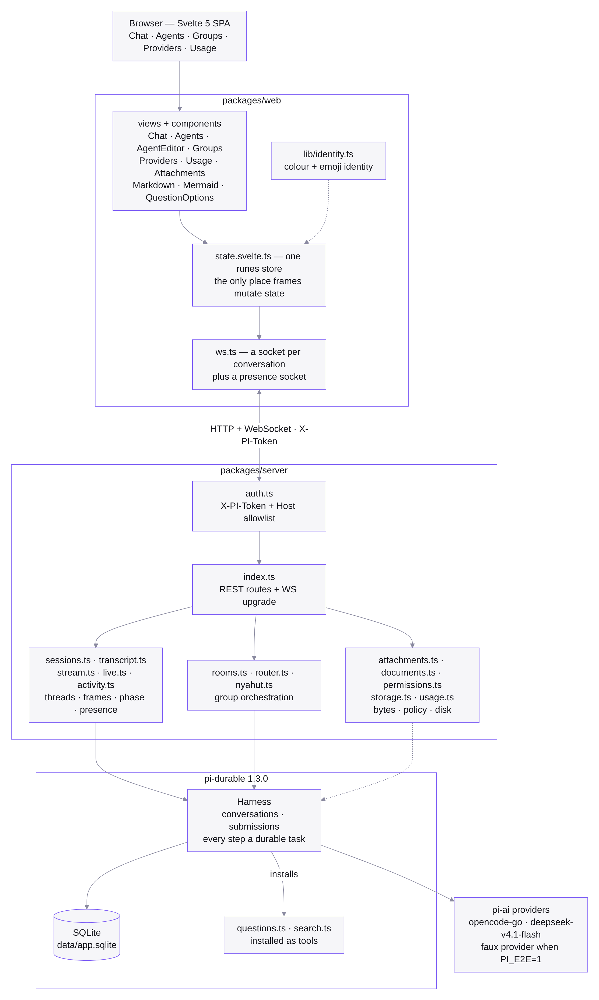
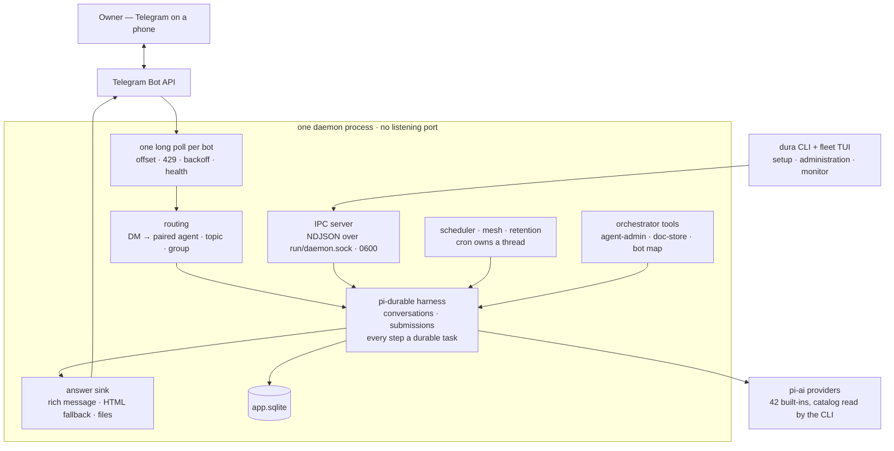

# Agents That Survive a Crash

> A local agent fleet you drive from Telegram: one daemon owns the durable state, so a
> dropped long poll, a killed process or a lost network costs you nothing. Agents can
> message each other, run on schedules, edit their own system — and there is no browser
> left to reload.

| | |
| --- | --- |
| **Repository** | [github.com/mariobgsp/durable-agents](https://github.com/mariobgsp/durable-agents) |
| **Role** | TypeScript / systems engineering: durable execution, transport design, process supervision |
| **Stack** | Node + TypeScript (`packages/cli` · `packages/core` · `packages/telegram`) · one daemon over a `0600` Unix socket · Telegram Bot API · SQLite via `@earendil-works/pi-durable` 1.3.0 |
| **Verified** | Re-read against `61ddadb` (2026-10-30). Checks are my run at `9138f67`; the only commit since is the README fix below: `npm run check` clean, `npm run e2e` 23/23, `npm run bench` 5/5 at 222 MB peak PSS. |
| **Order** | 2 |

## At a glance

- **What it is** — a single-user agent fleet with no web app: one daemon owns the
  durable conversations, a CLI does setup and administration, `dura monitor` renders
  the fleet, and **one Telegram bot per agent** is the chat surface.
- **Who it's for** — someone who treats an agent session as work rather than a prompt:
  long threads, expensive generations, a phone as the client, and a strong preference
  not to lose either because a long poll died mid-answer.
- **The interesting part** — durability is not a save button and not a UI feature. It is
  a durable task log inside one process, and the transport is treated as disposable:
  Telegram can fail, rate-limit, or be replaced, and the run carries on.

## The problem

A chat UI that keeps the conversation in the client breaks as soon as a turn costs money
and takes minutes. Moving the same assumption to a phone transport does not fix it, it
hides it:

- **A dropped connection loses the answer.** The generation completes upstream, but
  nothing durable owns it, so the reply never lands.
- **A restart forgets what was in flight.** There is no record that a turn was running,
  so resuming means re-asking and re-paying.
- **"Still working?" has no answer.** A typing indicator cannot distinguish a slow
  generation from a dead one, and in a group it cannot say *which* agent is mid-sentence.
- **A second message is a second question.** Send another line to a busy chat and most
  systems queue a new turn behind the first, so the correction arrives after the money is
  spent.

This project inverts the ownership: the daemon writes durable tasks first, and the
transport is a view onto that log.

## What it does

| Capability | How |
| --- | --- |
| **Durable threads** | Every message, tool call and generation is a durable task in `app.sqlite`. `resume()` replays interrupted work, and an answer is read out of the log rather than off a socket. |
| **Steering, not queueing** | A message sent while a run is live is steered into it (`whenBusy: "steer"`) and answered with `Steer · added to the current run`. `/stop` aborts the run and withdraws the queued messages. |
| **One bot, one agent** | A bot belongs to exactly one agent, so identity is never ambiguous. An unpaired bot answers only the owner with a pairing prompt; pairing takes a token (`/connect <agent> <token>`, the token message is deleted, or `bot_connect` from the orchestrator), never browser automation. |
| **Agents as files** | `agents/<id>/{agent.json,AGENT.md,SOUL.md,MEMORY.md,.history/}`. Every mutation goes through one admin pipeline — validate, write, rebind, reconcile mesh and schedules — and a filesystem watcher rebinds a hand edit. |
| **Orchestrator** | A config pointer, not a special agent: role-scoped tools (`agent_admin_list`, `agent_read`, `agent_create`, `agent_update`, `agent_set_enabled`, `agent_delete`, `bot_list/assign/release/connect`, `mcp_*`) plus `agent_write_doc` with a sha256 guard, patch mode, a 64 KiB cap and five versions of history. Any agent may call `orchestrator_claim`; if an orchestrator already exists the owner gets Approve/Deny buttons. |
| **Groups** | Three modes — `Nyahut` (agents claim a message by responsibility), `Moderator`, `Silent` — with one speaker bot per room and a `chatId+messageId` seen-map that suppresses duplicates when several bots are present. |
| **Agent network** | `agents_message` delivers to one directed inbox thread per sender–recipient pair; `agents_delegate` creates one task thread per target. Calls are idempotent by request id. |
| **Schedules** | A per-agent 5-field cron owns one thread: run-now, skip-when-busy, restart-safe; a missed window is counted, not replayed. |
| **Global MCP** | stdio servers installed once, exposed to every agent as `mcp__<server>__<tool>`, with every conversation rebound on install or removal so existing threads gain the tools immediately. |
| **Bounded data** | Retention is automatic: threads older than 3 days are soft-deleted, tombstones are exported and purged 3 days later, then vacuumed. Before a batch disappears, one summary per agent is appended to its `MEMORY.md`. |
| **Operations** | A five-step resumable `dura init`, `dura verify` (provider, bot identity, owner delivery, socket/no-TCP, SQLite, one live agent round-trip) which writes `setup.verifiedAt` only on a pass, plus `status`, `monitor`, `logs -f` and `doctor`. |

## How it works



<details>
<summary>Mermaid source (<code>diagrams/durable-agents.mmd</code>)</summary>



</details>

### Components

- **`packages/core/src/daemon.ts`, `ipc.ts`** — the one process: harness, SQLite,
  scheduler, mesh, run limiter, IPC server and a poller per bot. A lockfile with a
  liveness check enforces a single instance, and a second `dura start` exits **4**.
  Readiness is a `0600` file plus one `DURA_READY` line on stdout, so a detached start
  needs no pipe.
- **`packages/cli/src/client.ts`, `commands/monitor.ts`** — the CLI is a client and
  nothing else: it reads files, or speaks NDJSON (`{"id","method","params"}` →
  `{"id","ok","result"}`, with `{"event":"fleet"}` pushes) over the socket. Exit codes
  are part of the contract: 0 ok, 1 runtime, 2 usage, 3 daemon unavailable, 4 refused.
- **`packages/core/src/stream.ts`, `live.ts`** — durable entries to wire messages, and
  the one reader of `pi.live` that derives the phase, the tool calls and the run's real
  elapsed time.
- **`packages/telegram/src/runtime.ts`, `client.ts`, `render.ts`** — one `getUpdates`
  loop per bot with its own offset and health in `telegram/state.json`; a 20-second long
  poll, `429` honouring `retry_after`, failures backing off 1 s → 15 s, `401`/`409`
  stopping that bot only, and a shutdown that aborts the in-flight poll instead of
  waiting it out. `render.ts` holds the coalescing edit sink and the rich/HTML answer
  path.
- **`packages/core/src/agent-admin.ts`, `orchestrator.ts`, `doc-store.ts`** — the single
  write path for agent records, the role guard, and the document store with its sha256
  guard and history.
- **`packages/core/src/retention.ts`, `sessions.ts`, `storage.ts`** — prune reads the
  index once and writes it once, purge exports one transcript at a time, then vacuum
  reclaims the file.
- **`packages/core/src/cron.ts`, `schedules.ts`, `mesh.ts`, `mesh-tools.ts`, `rooms.ts`,
  `nyahut.ts`** — schedules, the directed agent network, and group orchestration.

### One message, end to end

1. You type into a bot's chat. That bot's poller holds its own offset; the update is
   claimed once, and commands bypass the thread binding.
2. Routing: a DM goes to the bot's paired agent and its active thread, a reply routes to
   the thread that produced the message, a topic gets one durable thread.
3. The daemon submits an `input` to that conversation and answers the chat with a short
   `Think · planning the next step` placeholder. **The submission is already durable
   when its id comes back**; a refusal throws before anything is written.
4. While the run is live, one status message — not one per call — is edited at most every
   1.2 s. It shows the phase (or the thinking text as it streams) and the **last three
   calls in the call's own words** (`⚙️ bash: git status`, `⚙️ read: core/src/live.ts`),
   because twenty notifications for twenty reads is noise. A message you send now is
   steered into the run instead of forming a new turn.
5. On completion the committed entry is read out of the log and sent with
   `sendRichMessage` (GFM headings, tables, task lists, long code), falling back to HTML
   `sendMessage` when the API rejects it. Generated files follow as documents.
6. If the daemon dies at any point, the work is still in SQLite: the next poller sees the
   same conversation, so the answer is delivered from the log rather than re-asked.

### Why there is no listening port

The daemon binds nothing. The CLI and the TUI connect over `run/daemon.sock`, mode
`0600`, and the only network traffic is outbound Bot API calls and the provider. That
removes the entire class of problems a local HTTP surface brings with it — token
injection, `Host` allowlists, CORS, a port that some other process can reach — and it is
why the previous version's Tailscale runbook, `X-PI-Token` and token-in-page bootstrap
are gone rather than relocated.

The price is honest: the chat surface is Telegram, so the phone story is "message a bot"
rather than "open a URL", and anything the CLI cannot do has to become a command or a
menu. `dura monitor` is deliberately the last of those: a read-only fleet TUI whose only
write is an explicit add-agent form.

## Key choices

| Choice | Why | Cost |
| --- | --- | --- |
| **Durability belongs to the daemon** | The harness writes the task first, so "the phone went to sleep during a four-minute generation" is a supported path rather than data loss. | Every surface has to render state it did not create, including re-attaching to a run it never started. |
| **The transport is disposable** | Telegram can rate-limit, drop a long poll or be replaced; none of that is allowed to touch a run. | The answer path has two formats and a coalescing edit sink, and the API's limits become load-bearing. |
| **One bot per agent** | Identity is unambiguous: a message to that bot is that agent, never a shared roster. | Onboarding needs a bot token per agent, and a bot cannot add group members, so the CLI mints an invite link. |
| **Steer instead of queue** | A correction reaches the run in flight, so you are not billed for the answer you were about to cancel. | The transport must edit a live message, and `/stop` has to withdraw a queue rather than just abort. |
| **Streaming reads `pi.live`** | The provider never emits `message_update`, so the daemon diffs the durable message in flight. | An internal shape is load-bearing; the clean fix belongs upstream. |
| **Retention is a feature, not a cleanup** | An 8 GB host with SQLite and images needs a bound, and one summary per agent keeps the gist. | The default is 3 days; anything older is gone unless `config.json` says otherwise. |
| **A measured memory gate** | Five agents with full tools must fit under 2 GB, enforced by a benchmark and by systemd `MemoryHigh`/`MemoryMax`. | A run limiter (5 active, 20 queued) means you wait, and the gate has to be re-run, not assumed. |

## Running it

```bash
git clone https://github.com/mariobgsp/durable-agents && cd durable-agents
npm install
npm link                 # optional: `dura` on PATH
dura init                # five steps, resumable
dura status              # daemon, bots, agents, runs, memory, verification time
dura verify              # the connection test, any time
dura monitor             # fleet TUI: q quit, r refresh, a add agent
dura logs -f             # JSON lines: lifecycle, connection, conversations, errors
```

`dura init` is strictly sequential and resumes at the first unfinished step:

| Step | What it does |
| --- | --- |
| 1 Agents | Asks for the orchestrator when missing, offers a replacement when present, stages extra agents. Nothing is written yet. |
| 2 Provider | Detects existing credentials, defaults to opencode-go / deepseek-v4.1-flash, or adds any built-in provider by API key (validated before saving). |
| 3 Telegram | Adds bots (`getMe` validated), binds the owner with a short `/start` code, assigns a home bot per agent, then writes the staged agents atomically. |
| 4 Service | Offers the systemd user unit and reports zram/sysctl tuning. |
| 5 Connection test | Starts the daemon and proves provider completion, bot identity, owner delivery, socket/no-TCP, SQLite and one live agent round-trip. Only a pass writes `setup.verifiedAt`. |

Keys never come from argv or through Telegram: a provider key is a hidden prompt, stdin
(`--key-stdin`) or the environment, saved `0600`; bot tokens live in
`secrets/telegram.json`, `0600`. Vault values are AES-256-GCM.

```text
~/.dura-file/                  (DURA_HOME overrides)
  config.json                  0600
  credentials.json             provider keys, 0600
  secrets/telegram.json        bot tokens, 0600
  app.sqlite                   durable conversations, tasks, entries
  agents/<id>/                 agent.json, AGENT.md, SOUL.md, MEMORY.md, .history/
  artifacts/<conversation>/    generated files
  vault/                       secrets and key
  telegram/                    users.json, state.json (offsets, bindings)
  logs/daemon.log[.1..3]       JSON lines, rotated
  run/daemon.sock              0600 control socket
```

Agents default to permission tier **full**, cwd `$HOME`, every tool. That tier is a
policy, not a sandbox: the operating-system account is the boundary, and the systemd
unit's `MemoryMax` is the only hard limit on the process.

### What I observed

These are my own numbers, run on a clean worktree of `9138f67` on this machine:

| Check | Result |
| --- | --- |
| `npm run check` | `tsc` clean; `check-language: clean — no Indonesian markers in system files` |
| `npm run e2e` | **23 passed, 0 failed**, 68 s wall — `telegram-chat`, `telegram-steer`, `telegram-stop`, `bot-pairing`, `bot-token-connect`, `orchestrator-claim(-approval)`, `mcp-global`, `retention`, `thread-prune`, `verify`, `tui-json` and the rest |
| `npm run bench` | **5/5 completed**, 4.6 s wall, peak PSS **222 MB** (gate 2048 MB), p95 199 MB, p50 84 MB |
| `dura provider models opencode-go` | 29 models, one per row |
| `dura provider list --all` | 42 providers |

The E2E suite is not a mock of the transport: `scripts/e2e/harness.mjs` boots a real
daemon in a temporary home with the faux provider and a fake Bot API, injects updates and
inspects the messages, edits, callbacks, files and SQLite rows that come back. The bench
(`scripts/bench/five-agents.mjs`) runs the same tool-heavy script in five conversations at
once and samples PSS for the daemon and every descendant every 100 ms.

## In use

The surface is a chat and a terminal, so what used to be screenshots is a command
surface. `tools/capture/durable-agents.mjs` runs the CLI out of the pinned checkout with a
throwaway `DURA_HOME` — no daemon, no socket, no model call — and writes exactly this
(`dura-agents 0.1.0`, 42 providers, 29 models on `opencode-go`):

```text
dura-agents CLI

Usage: dura <command> [options]

Setup
  init                 Guided setup: agents, provider, telegram, service, connection test
  verify               Run the connection test against a running daemon
  start                Start the daemon (foreground on a terminal, background otherwise)
  stop                 Stop the daemon
  restart              Stop then start the daemon
  status               Daemon, bots, providers, runs and memory
  logs                 Read or follow the daemon log

Configuration
  config               get, set, edit or validate config.json
  bot                  Telegram bot registry: add, list, remove, test, default
  provider             Providers: list, add, models, test, remove, default
  agent                Agents: list, show, create, set, enable, disable, delete, docs
  orchestrator         Show, set, create or replace the orchestrator
  user                 Allowlist: list, add, remove, pending, approve, invite
  service              Install, remove or inspect the systemd user unit
  tune                 Report or apply zram/sysctl tuning
  migrate              Copy an older data directory into DURA_HOME

Use
  mcp                  Global MCP servers: list, add, remove, reload, tools
  thread               List, prune, restore or purge threads (--purge --vacuum to reclaim space)
  monitor              Fleet TUI (read-only, plus an explicit add-agent form)
  usage                Usage report
  memory               Agent memory notes
  schedule             Cron schedules
  storage              Size report, cleanup, purge
  vault                Secret vault names and values
  doctor               Diagnostics
  update               Update packages and reload tools
  bench                Five-agent memory benchmark

Global: --json, --help, --version, --home <path>
```

The model catalog behind `/model`, first rows of the 29:

```text
model                       context  input       cost/1M in
claude-haiku-5-5            1000000  text,image  0.1
minimax-m3                  1000000  text,image  0.3
qwen3.7-plus                1000000  text,image  0.4
qwen3.8-flash               1000000  text,image  0.15
qwen3.8-max                 1000000  text,image  2
gemini-4-argon-contributor  1048576  text,image  4
cat-jam-free                262144   text        0
deepseek-v4-pro             1000000  text        0.66
…
```

A run in the chat has this shape — the placeholder, the edited status card, then the
answer. The strings are the transport's own, from `packages/telegram/src/runtime.ts`:

```text
you   why did the nightly backup skip Tuesday?
bot   Think · planning the next step
bot   🧠 the schedule says Tuesday ran at 02:00…
      ⚙️ bash: rg -n "02:00" ~/backups/schedule.conf
      ⚙️ read: /var/log/backup.log
      ⚙️ bash: journalctl -u backup --since 02:00
you   also check Wednesday
bot   Steer · added to the current run
bot   <the answer, rich-formatted: headings, a table, a code block>
```

## What I'd fix next

- **The group path has no end-to-end scenario.** `nyahut`/moderator/silent routing is
  exercised by the room code, not by the transport: there is no E2E proving that a
  Telegram group, a bound room and one speaker bot actually produce the right answer.
- **MCP is stdio only.** No HTTP or streamable transport yet, and an MCP server runs with
  the daemon's own OS permissions, so installing one is trusted-code territory.
- **The benchmark measures the wrong half of the risk.** It uses the faux provider, so it
  measures daemon memory under tool load — not a real provider's network buffers. The
  repository also quotes 246 MB and 247 MB for the same run in two other documents; PSS
  moves with the rest of the machine, so the gate is the number worth reading, not the
  third digit.
- **`dura tune` does not install anything.** When no zram device exists it prints the
  zram-generator configuration instead of applying it.
- **Direct chats are strictly one bot per agent.** A group is the only multi-agent
  surface, and a bot cannot add members: `dura user invite --chat <id>` plus
  `dura user add <id>` is the manual path.
- **Voice, video, per-agent hooks and a skills curator are not implemented.** Not
  started, and the roadmap says so rather than implying otherwise.
**Two documentation defects, found by reading the code and fixed upstream.** The README
showed progress lines as `Bash · running a command · step 1`; `progressLine()` in
`packages/telegram/src/runtime.ts` emits `bash: git status`-style lines, keeps the last
three, and has no step counter anywhere in the path. And the benchmark table was followed
by a raw `\textit{This run used the offline faux provider; …}` line, which GitHub renders
as a code block rather than an italic caveat. Both are corrected in
[`#3`](https://github.com/mariobgsp/durable-agents/pull/3) — the commit this article pins.

## Links

- **Source:** [github.com/mariobgsp/durable-agents](https://github.com/mariobgsp/durable-agents)
- **Harness:** [`@earendil-works/pi-durable`](https://www.npmjs.com/package/@earendil-works/pi-durable) (pinned 1.3.0)
- **Plan of record:** [`docs/roadmap.md`](https://github.com/mariobgsp/durable-agents/blob/main/docs/roadmap.md)
- **CLI and daemon:** [`docs/design/cli.md`](https://github.com/mariobgsp/durable-agents/blob/main/docs/design/cli.md)
- **Telegram transport:** [`docs/design/telegram.md`](https://github.com/mariobgsp/durable-agents/blob/main/docs/design/telegram.md)
- **Orchestrator and administration:** [`docs/design/orchestrator.md`](https://github.com/mariobgsp/durable-agents/blob/main/docs/design/orchestrator.md)
- **Memory budget:** [`docs/design/memory-budget.md`](https://github.com/mariobgsp/durable-agents/blob/main/docs/design/memory-budget.md)
- **The boundary:** [`deploy/dura.service`](https://github.com/mariobgsp/durable-agents/blob/main/deploy/dura.service)

---

*Verified against commit `61ddadb` (2026-10-30). Diagram source:
[`diagrams/durable-agents.mmd`](diagrams/durable-agents.mmd). Capture script:
[`tools/capture/durable-agents.mjs`](tools/capture/durable-agents.mjs) — the CLI surface,
because there is no browser left to photograph.*
