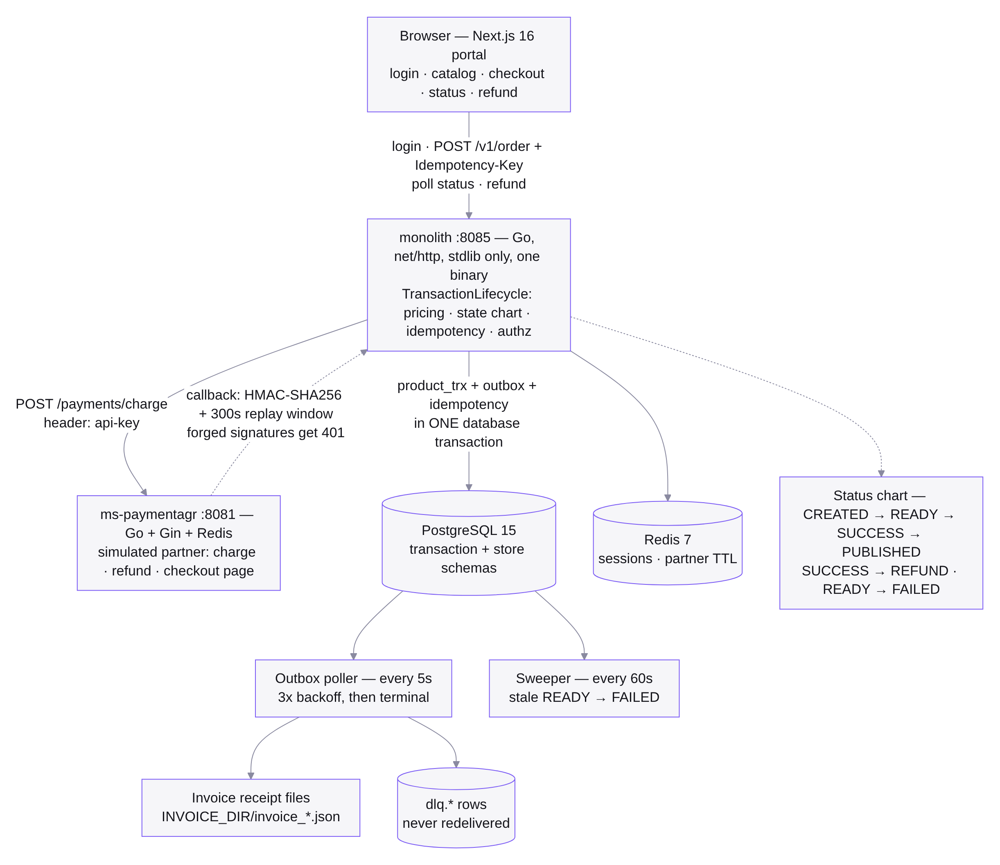
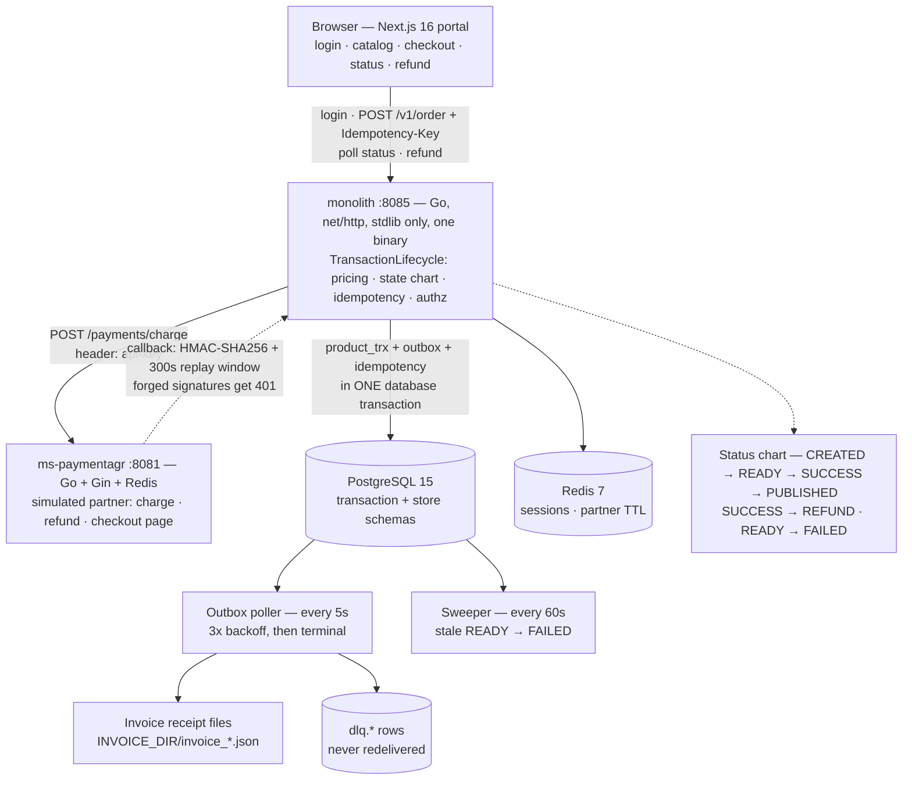
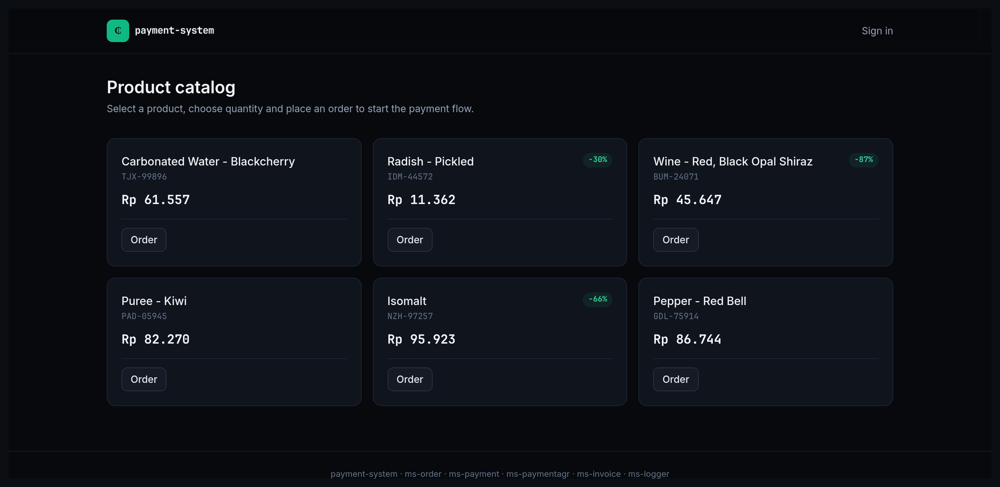
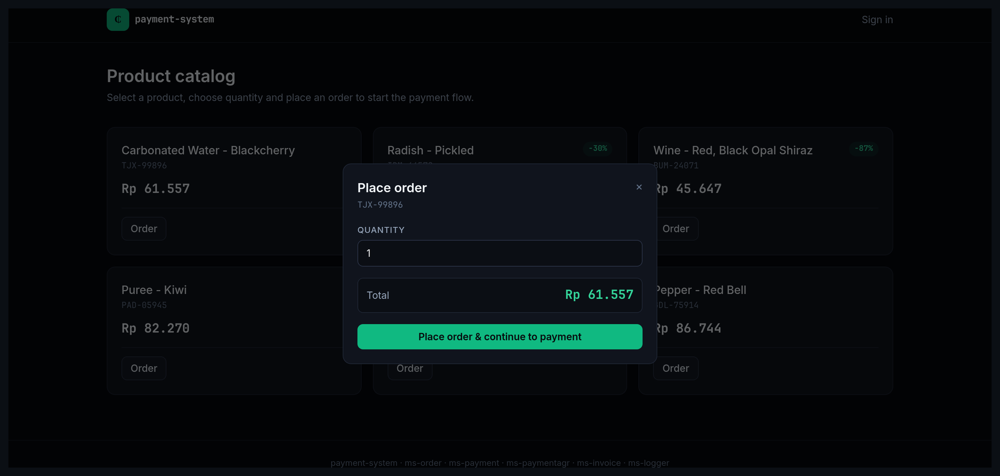
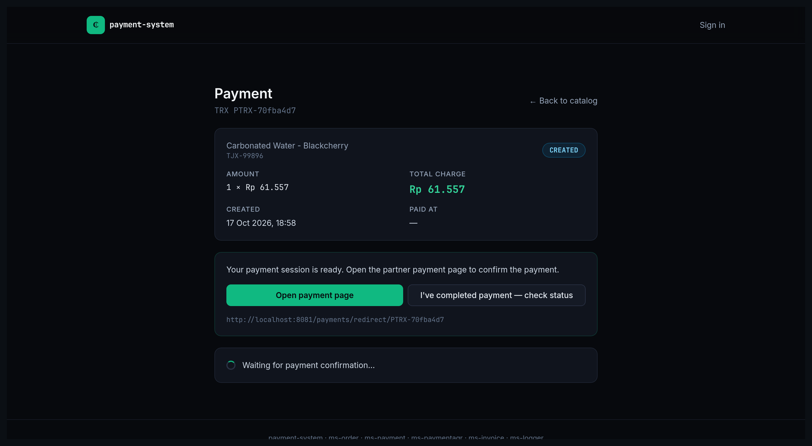
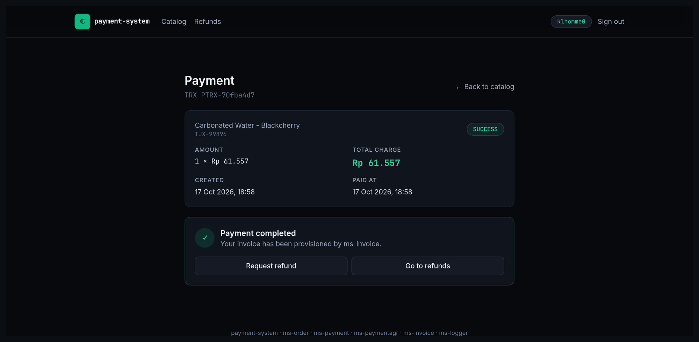
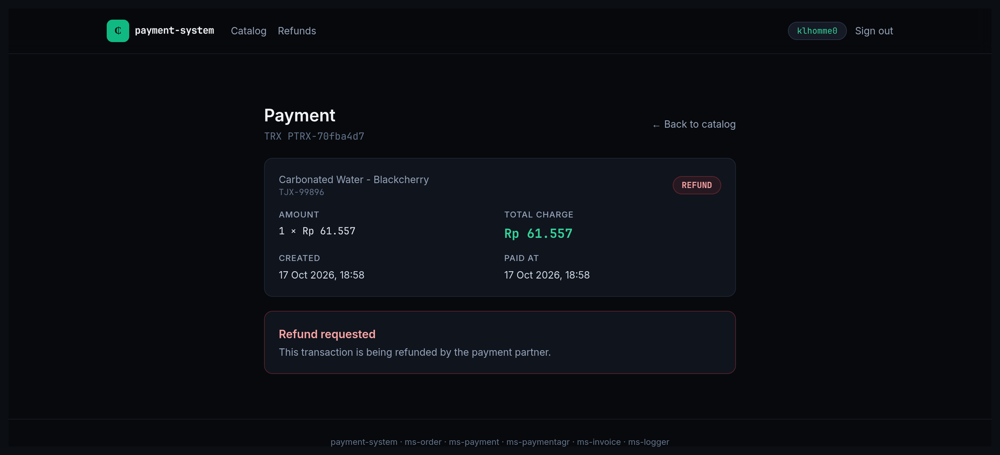
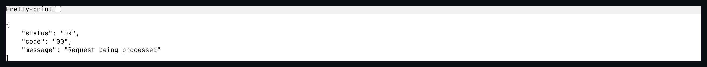

# Four Java Services, One Go Binary: a Payment Lifecycle Without Kafka

> This is a payment system that used to be four Java microservices talking through
> Kafka, Mongo and Zookeeper. It is now one Go binary, a Postgres schemas, and a
> database table doing the job the message broker used to do. All five containers
> start in one command.

| | |
| --- | --- |
| **Repository** | [github.com/mariobgsp/payment-system](https://github.com/mariobgsp/payment-system) |
| **Role** | Backend engineering, distributed-systems consolidation, security hardening |
| **Stack** | Go (`net/http` stdlib) · PostgreSQL 15 · Redis 7 · Next.js 16 portal · Docker Compose |
| **Verified** | All five containers built and run locally (2026-10-17); the full lifecycle was driven end to end and screenshotted. |
| **Order** | 4 |

## At a glance

- **What it is** — a payment lifecycle for a storefront: order → charge → signed
  callback → invoice → refund, with idempotency, authorization, pricing and
  audit logging on the same path.
- **Who it's for** — teams paying the operational tax of microservices they do not
  need: four deployables, a broker and two databases for one business process.
- **The interesting part** — the **outbox pattern replaced Kafka without
  replacing Kafka's guarantees**: atomic writes, at-least-once delivery, retry with
  backoff, and a terminal dead-letter table that is never redelivered. Plus a
  documented, measured trigger for splitting the monolith again.

## The problem: a broker for a two-schema system

The original design split the payment lifecycle across `ms-order`, `ms-payment`,
`ms-invoice` and `ms-logger`, wired through Kafka, Mongo and Zookeeper. That
architecture has real advantages — independent scaling, independent deploys,
blast-radius isolation — and none of them were being used here:

- **There was nothing to scale independently.** Order, charge and refund are one
  lifecycle with one transaction boundary. Splitting them made the *transaction*
  distributed, so consistency had to be re-derived with sagas and compensation.
- **Kafka was a delivery mechanism, not a stream processor.** Every message was
  consumed once, keyed to one transaction, with no replay requirements beyond
  retry. A Postgres table with a poller covers that.
- **Mongo held logs that had one access pattern** — newest-first, by transaction,
  with a 30-day retention window. That is a `SELECT` with an index.

The rewrite keeps the guarantees and removes the moving parts: five containers,
one Go binary for the domain, one database with two schemas.

## What it does

| Capability | How |
| --- | --- |
| **Transaction lifecycle** | One `TransactionLifecycle` module owns the status chart: `CREATED → READY → SUCCESS → PUBLISHED`, plus `SUCCESS → REFUND` and `READY → FAILED`. |
| **Idempotency** | `Idempotency-Key` on order creation, `transactionId` as the natural key for charge and refund. The key insert and the transaction insert share one database transaction. |
| **Atomic outbox** | `product_trx`, the outbox row and the idempotency record are written in a single transaction, so a state change can never exist without its event. |
| **Signed callbacks** | Partner callbacks carry `x-callback-signature` (HMAC-SHA256) and `x-callback-timestamp`; the monolith verifies both against a 300-second replay window, and returns 401 for a forgery. |
| **Retry and dead-lettering** | A 5-second poller retries 3× with backoff, then writes to `dlq.*` and never redelivers. |
| **Stale-state sweeping** | A 60-second sweeper moves `READY → FAILED` after 5 minutes and purges processed logs past their retention window. |
| **Invoice provisioning** | The outbox poller emits a receipt file per settled transaction. |
| **Audit query** | `GET /v1/logs?limit=` serves the log rows with retention. |
| **Session identity** | Short-lived opaque session tokens with a 60-second eviction ticker, plus login rate limiting (10 attempts / 15 minutes). |

## Why this stack

| Layer | Choice | Why this — and not the obvious alternative |
| --- | --- | --- |
| Domain language | **Go monolith, `net/http` standard library** | One binary to build, ship and reason about. The routing table is a Go slice, so the endpoint list is readable in one file. A framework would add a middleware order to learn before you can read your own request path. |
| Consistency | **Postgres outbox in one transaction** | The alternative is a broker plus a saga. Here the state change and the event are *the same commit*, so "the payment succeeded but nothing was notified" is not a reachable state. |
| Delivery | **Polling worker with backoff and a DLQ** | At-least-once with an explicit terminal state, without a broker to operate. The trade is latency (a 5-second poll) for one fewer system. |
| Persistence | **Two schemas in one database** | `transaction` and `store` in a single DSN keeps joins and transactions possible. Separate databases would reintroduce distributed consistency at the storage layer — the exact problem being removed. |
| Cache | **Redis for sessions and partner TTLs** | Ephemeral, TTL-shaped data. Deliberately *not* used for anything the lifecycle depends on, so a Redis restart cannot corrupt a payment. |
| Portal | **Next.js 16 App Router** | The portal is a client of the monolith through BFF routes; no business rule lives in the frontend. |
| Legacy compatibility | **`/ms/api/v1/*` routes on the same monolith** | The old frontend contract keeps working while the new `/v1/*` API grows, so the migration did not require a flag day. |

## Architecture



<details>
<summary>Mermaid source (<code>diagrams/payment-system.mmd</code>)</summary>



</details>

### Component walkthrough

- **`monolith/lifecycle/`** — the deep module: the status chart, pricing and
  discount math, idempotency and authorization. Every caller that wants to move a
  payment goes through it.
- **`monolith/store/`** — the persistence seam: `pg.go` for production,
  `memory.go` as a fake, `store.go` for the types. The e2e suite runs on the fake
  with no database.
- **`monolith/jobs/`** — the outbox poller and the sweeper, each small enough to
  read in one sitting.
- **`monolith/cmd/`** — `routes.go` (one table for every endpoint), `handlers.go`
  (the new API), `legacy.go` (the `ms-*` compatibility surface), `http.go`
  (envelopes, partner transport, outbox transport).
- **`ms-paymentagr/`** — a deliberately separate service: an external payment
  partner is a different failure domain, so it stays a separate binary and speaks
  to the monolith through a signed callback. That separation is real, unlike the
  four-way split inside the lifecycle.

### The lifecycle, end to end

1. **Sign in** — BCrypt verification against `store.store_user`; the monolith
   issues a short-lived opaque session token.
2. **Place an order** — price and discount are computed inside
   `TransactionLifecycle`, then `product_trx` (`CREATED`), one outbox row and one
   idempotency row are inserted **in a single transaction**.
3. **Create payment** — `CREATED → READY`, and the partner is called with an
   `api-key` header. A duplicate call returns the same `CheckoutUrl` instead of
   charging twice.
4. **Callback** — the partner posts a signed event; the monolith verifies the HMAC
   and the timestamp window, then `READY → SUCCESS/PUBLISHED` with an outbox row.
5. **Sweep and retry** — the poller routes the outbox (retrying 3× then
   dead-lettering), and the sweeper fails stale `READY` rows after 5 minutes.
6. **Invoice** — the outbox poller writes a receipt file for the settled
   transaction.
7. **Refund** — `SUCCESS → REFUND`; a second refund is a 409, not a double refund.

## Architecture decisions worth defending

**Write the event in the same transaction as the state change.**
*Cost:* outbox rows live in the hot database and need retention management.
*Benefit:* the classic "the payment committed but the notification vanished"
window does not exist, because there is no window — it is one commit. This is the
decision that made a message broker unnecessary.

**A terminal dead-letter state instead of infinite retry.**
Poison rows get 3 attempts with backoff, then land in `dlq.*` and are **never
redelivered**. *Cost:* someone has to look at the DLQ, and there is no automatic
recovery. *Benefit:* a malformed event cannot pin a worker forever, and the failure
is visible as data instead of as noise in a log.

**Keep the monolith until a measurement says otherwise.**
The repo states the split triggers explicitly: a module's change rate causing merge
contention, a resource profile that diverges under load, or a crash in one module
taking down the others. It also states what does *not* justify a split: "Do not
split for code size alone — total tokens don't shrink, they scatter across repos."
*Cost:* one deployable for the whole lifecycle. *Benefit:* the decision has a test
rather than a preference, and the cheapest module to extract first (invoice) is
already named, with a `docker-compose.split.yml` to try it.

**Fail closed on the partner call.**
When `PARTNER_CHARGE_URL` is set and the partner errors, the monolith returns a
502 rather than optimistically marking the payment `READY`. *Cost:* a partner
outage stops new payments. *Benefit:* no customer is sent to a checkout page for a
charge the system never registered.

**Serve two API generations from one binary.**
`/v1/*` is the new contract; `/ms/api/v1/*` keeps the old frontend working.
*Cost:* two surfaces to maintain, and the legacy path is where the older weak
authorization lived (the repo documents that as an accepted exception with a
retirement plan). *Benefit:* the migration shipped incrementally instead of as a
cutover.

## Running it

```bash
cd project
cp .env.example .env          # change every secret
docker compose up --build     # postgres + redis + ms-paymentagr + monolith + frontend

# portal       http://localhost:3000
# monolith API http://localhost:8085   (/health, /v1/logs)
# partner      http://localhost:8081   (/health)

# tests
cd monolith && go vet ./... && go test ./... -count=1
cd ms-paymentagr && go vet ./... && go build ./...
cd frontend && npm ci && npm run build
```

Seeded demo users come from `project/pg-init-scripts/sql/20-store-schema.sql`
(for example `klhomme0` / `user1Pass!`).

### What I observed

The five-container stack came up clean and the lifecycle ran end to end: a real
order, a real charge against the simulated partner, a real signed callback, a real
invoice file written by the outbox poller, and a real refund. The status chart
walked `CREATED → READY → SUCCESS → REFUND`, and the invoice the poller wrote
contains exactly the settled state:

```json
{
  "generatedAt": "2026-10-17T11:57:15Z",
  "orderStatus": "PUBLISHED",
  "paymentDate": "2026-10-17 11:57:14",
  "paymentStatus": "SUCCESS",
  "price": 61557,
  "priceCharge": 61557,
  "productCode": "TJX-99896",
  "transactionId": "PTRX-22b7a774"
}
```

I found two real defects by driving the stack instead of reading it. Both are
described in [What I'd fix next](#what-id-fix-next) with the exact code paths,
because they are the most useful thing a run can produce.

## Screenshots



*The portal after sign-in. Prices and discount availability come from
`store.product` through the monolith; the frontend holds no pricing logic.*



*Placing an order. The BFF sends an `Idempotency-Key`, which is why a double-click
cannot create two transactions.*



*`READY`: the charge reached the partner, the checkout URL is live, and the status
badge is driven by the monolith's own state chart rather than by the client's opinion.*



*`SUCCESS` after the partner's signed callback was verified. The invoice exists
because the outbox poller wrote it — visible in the container at
`/tmp/invoices/invoice_<trx>.json`.*



*`REFUND` after the refund path. A second refund attempt returns 409.*



*The simulated partner's side of the flow: `GET /payments/redirect/{trxid}` mints
the payment session and fires the signed callback in the background. This screen is
where the callback defect in [What I'd fix next](#what-id-fix-next) becomes visible —
the partner reports success while the monolith stays at `READY`, because the event
it sends cannot be matched to a transaction.*

## What I'd fix next

**1 — The legacy compat endpoint answers in `snake_case`, and the new checkout
screen reads `camelCase`, so the page crashes.**
The monolith exposes two generations of the same query: `/v1/*` returns
`transactionId`, `priceCharge`, `orderStatus`; the legacy `/ms/api/v1/*` route
returns `transaction_id`, `price_charge`, `order_status`. The checkout page's
`ProductTrx` type describes the camelCase shape, so:

```text
PAGEERROR: Cannot read properties of undefined (reading 'toLocaleString')
```

`formatIdr(trx.priceCharge)` is called with `undefined` and React unmounts into the
error boundary. The frontend also renders no error state of its own, so the user
sees "This page couldn't load" with no clue that a field name is the cause. Either
normalise the legacy response in the BFF (one mapping, one place) or pin the
contract with a test — a screen that crashes on a field rename is exactly what a
generated type shared with the backend would have prevented.

**2 — The partner's callback payload does not match the monolith's callback
contract, so a payment can never reach `SUCCESS` through the normal partner flow.**
`ms-paymentagr` signs and sends its `ChargeRs` struct, whose JSON key is
`reference_id`. The monolith's `CallbackEvt` reads `referenceId`. Go's decoder
matches field names case-insensitively but not across an underscore, so the
identifier arrives empty and `OnCallback` rejects the event as invalid. Proven
with two otherwise-identical signed requests:

```text
{"reference_id":"PTRX-22b7a774","status":"SUCCEEDED"}  ->  HTTP 400  {"code":"01","message":"LC: invalid callback"}
{"referenceId": "PTRX-22b7a774","status":"SUCCEEDED"}  ->  HTTP 202  {"code":"00","message":"Request being processed"}
```

The signature verification is correct on both sides — the HMAC covers
`timestamp + body` identically — so this is purely a field-name mismatch, and it
fails silently from the partner's perspective: the poller's 3 retries expire, the
payment sits at `READY` forever, and neither service logs a contract error.
Mapping the payload in one shared place, or asserting the callback shape in the
partner's own test suite, is the fix.

**3 — Smaller items.** The Compose file pins Postgres to `15-alpine3.17`, which is
unmaintained; the seeded demo users ship with real BCrypt hashes in the init SQL,
which is convenient locally and a habit worth breaking; and `payment_date` is
populated at `READY` rather than at settlement, which reads oddly in the UI before
the callback lands.

## Links

- **Source:** [github.com/mariobgsp/payment-system](https://github.com/mariobgsp/payment-system)
- **Domain language:** [`specs/tech-architecture/tech-stack.md`](https://github.com/mariobgsp/payment-system/blob/main/specs/tech-architecture/tech-stack.md)
- **Accepted exceptions:** [`specs/security/EXCEPTIONS.md`](https://github.com/mariobgsp/payment-system/blob/main/specs/security/EXCEPTIONS.md)
- **PlantUML sources:** [`assets/`](https://github.com/mariobgsp/payment-system/tree/main/assets)

---

*Verified against commit `6db1fe0` (2026-09-18). Diagram source:
[`diagrams/payment-system.mmd`](diagrams/payment-system.mmd). Capture script:
[`tools/capture/payment-system.mjs`](tools/capture/payment-system.mjs).*
