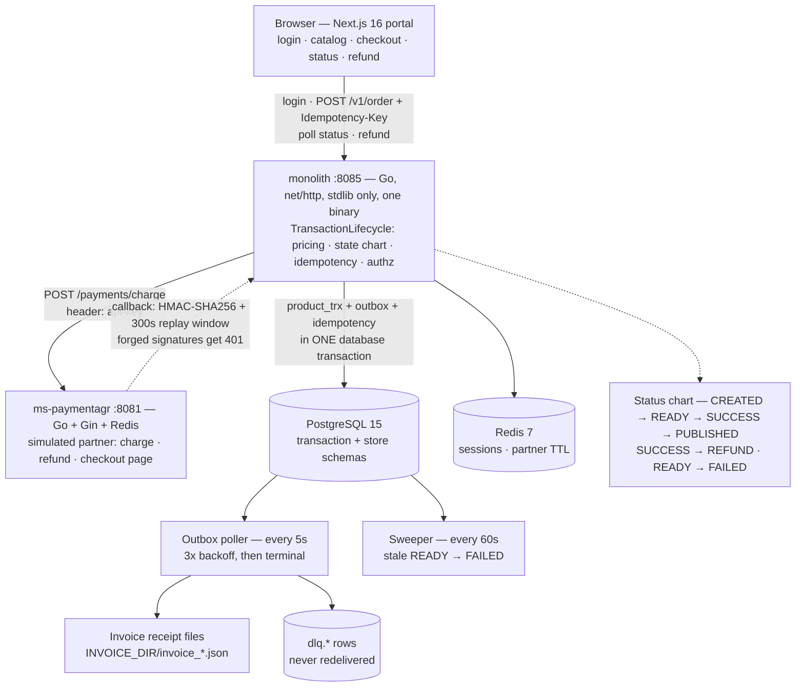

# One Go Binary Instead of Four Java Services

> This payment system used to be four Java microservices on Kafka, Mongo and
> Zookeeper. It is now one Go binary, two Postgres schemas, and an outbox table
> doing the job the message broker used to do. All five containers start with one
> command.

| | |
| --- | --- |
| **Repository** | [github.com/mariobgsp/payment-system](https://github.com/mariobgsp/payment-system) |
| **Role** | Backend engineering, distributed-systems consolidation, security hardening |
| **Stack** | Go (`net/http` stdlib) · PostgreSQL 15 · Redis 7 · Next.js portal · Docker Compose |
| **Verified** | Re-read against commit `084d207` (2026-10-28; a `tailwindcss` v3 pin that restores the frontend build). Screenshots and observed output are from the 2026-10-17 run. |
| **Order** | 4 |

## At a glance

- **What it is** — a storefront payment lifecycle: order → charge → signed
  callback → invoice → refund, with idempotency, authorization and audit logging.
- **Who it's for** — teams paying the operational tax of microservices they do not
  need.
- **The interesting part** — the outbox replaced Kafka without losing its
  guarantees: atomic writes, at-least-once delivery, retry with backoff, and a
  terminal dead-letter table.

## The problem

The original design split the lifecycle across `ms-order`, `ms-payment`,
`ms-invoice` and `ms-logger`, wired through Kafka, Mongo and Zookeeper. That
architecture had real advantages — independent scaling, deploys and blast
radius — none of which were used.

- **Nothing scaled independently.** Order, charge and refund share one transaction
  boundary; splitting them made consistency a saga problem.
- **Kafka was delivery, not stream processing.** Every message was consumed once,
  keyed to one transaction, with no replay beyond retry. A Postgres table and a
  poller cover that.
- **Mongo held logs with one access pattern:** newest first, by transaction, with
  30-day retention. That is a `SELECT` with an index.

The rewrite keeps the guarantees and removes the moving parts: one binary, one
database, two schemas.

## What it does

| Capability | How |
| --- | --- |
| **Transaction lifecycle** | `TransactionLifecycle` owns the status chart: `CREATED → READY → SUCCESS → PUBLISHED`, plus `SUCCESS → REFUND` and `READY → FAILED`. |
| **Idempotency** | `Idempotency-Key` on order creation; `transactionId` for charge and refund. Key and transaction share one commit. |
| **Atomic outbox** | The transaction row, its outbox row and its idempotency record are written in one commit, so a state change cannot exist without its event. |
| **Signed callbacks** | `x-callback-signature` (HMAC-SHA256) and `x-callback-timestamp`, checked against a 300-second replay window. Forgeries get 401. |
| **Retry and dead-lettering** | A 5-second poller retries three times with backoff, then writes to `dlq.*` and never redelivers. |
| **Sweeping and invoicing** | A 60-second sweeper fails stale `READY` rows after five minutes. The poller writes one invoice per settled transaction. |
| **Sessions and audit** | Short-lived opaque session tokens, login rate limiting, and `GET /v1/logs?limit=` over retained audit rows. |

## How it works


<details>
<summary>Mermaid source (<code>diagrams/payment-system.mmd</code>)</summary>



</details>

### Components

- **`monolith/lifecycle/`** — the deep module: status chart, pricing,
  idempotency, authorization. Every caller that moves a payment goes through it.
- **`monolith/store/`** — the persistence seam: `pg.go` for production,
  `memory.go` as a fake. The end-to-end suite runs on the fake with no database.
- **`monolith/jobs/`** — the outbox poller and the sweeper, each readable in one
  sitting.
- **`monolith/cmd/`** — the route table, the new API, the legacy compatibility
  surface, and the envelopes and transports in `http.go`.
- **`ms-paymentagr/`** — the simulated partner. An external partner is a different
  failure domain: a separate binary with a signed callback.

### One payment, end to end

1. **Sign in.** BCrypt verification against `store.store_user`; the monolith
   issues a short-lived opaque session token.
2. **Place the order.** Price and discount are computed in
   `TransactionLifecycle`, then the `CREATED` transaction, one outbox row and one
   idempotency row are inserted in a single transaction.
3. **Create the charge.** `CREATED → READY`; the partner is called with an
   `api-key` header. A duplicate call returns the same `CheckoutUrl`.
4. **Receive the callback.** The partner posts a signed event; the monolith
   verifies HMAC and timestamp, then moves `READY → SUCCESS/PUBLISHED` and writes
   an outbox row.
5. **Sweep and retry.** The poller routes the outbox (three attempts, then
   dead-letter); the sweeper fails stale `READY` rows after five minutes.
6. **Settle and refund.** The poller writes the invoice. A refund moves
   `SUCCESS → REFUND`; a second refund returns 409.

## Key choices

| Choice | Why | Cost |
| --- | --- | --- |
| **Outbox in the same transaction** | The state change and the event are one commit, so "payment succeeded but nothing was notified" cannot happen. | Outbox rows live in the hot database and need retention. |
| **Terminal DLQ** | A malformed event cannot pin a worker, and the failure is visible as data. | Someone must look at the DLQ. |
| **Monolith until measured** | The split triggers are named: merge contention, diverging resources, or a crash that takes the lifecycle down. | One deployable. |
| **Fail closed on the partner** | Partner errors return 502 instead of marking the payment `READY`. | A partner outage stops new payments. |

## Running it

```bash
cd project
cp .env.example .env          # change every secret
docker compose up --build     # postgres + redis + partner + monolith + frontend

# portal       http://localhost:3000
# monolith API http://localhost:8085   (/health, /v1/logs)
# partner      http://localhost:8081   (/health)

cd monolith && go vet ./... && go test ./... -count=1
cd ms-paymentagr && go vet ./... && go build ./...
cd frontend && npm ci && npm run build
```

The frontend build is the one command that was **not** green for a while. At
`0f2acef` a dependabot major bump had moved `tailwindcss` to 4.3.3 while
`globals.css` still uses the `@tailwind base/components/utilities` directives,
`tailwind.config.ts` uses the v3 `Config` type, and `postcss.config.mjs` registers
`tailwindcss` as a PostCSS plugin, which v4 no longer supports, so the build stops:

```text
Error: It looks like you're trying to use `tailwindcss` directly as a PostCSS plugin.
The PostCSS plugin has moved to a separate package, …
```

`084d207` pins it back to `^3.4.19`. I ran both sides in a clean worktree rather
than trusting the commit message: exit **1** at `0f2acef` with tailwind 4.3.3
installed, exit **0** at `084d207` in 41 s.

### What I observed

The five-container stack came up clean and the lifecycle ran end to end. The
status chart walked `CREATED → READY → SUCCESS → REFUND`, and the invoice contains
exactly the settled state:

```json
{
  "paymentStatus": "SUCCESS",
  "priceCharge": 61557,
  "transactionId": "PTRX-22b7a774"
}
```

Driving the stack surfaced two real defects.

## Screenshots


*`SUCCESS` after the signed callback; the outbox poller wrote the invoice.*


*The partner's side. It reports success while the monolith can stay at `READY` —
the callback defect below.*

## What I'd fix next

**1 — The legacy endpoint answers in `snake_case`, and the checkout page reads
`camelCase`, so the page crashes.** `/v1/*` returns `transactionId` and
`priceCharge`; `/ms/api/v1/*` returns `transaction_id` and `price_charge`. The
page expects camelCase, so `formatIdr(trx.priceCharge)` gets `undefined` and React
unmounts into an error boundary. Normalise the legacy response in the BFF, or pin
the contract with a shared type.

**2 — The partner's callback key does not match the monolith's contract, so a
payment can never reach `SUCCESS` through the normal partner flow.**
`ms-paymentagr` signs and sends `reference_id`; the monolith's `CallbackEvt`
reads `referenceId`. Go does not match across an underscore, so the identifier
arrives empty and the callback is rejected:

```text
{"reference_id":"PTRX-22b7a774", ...}  ->  HTTP 400  invalid callback
{"referenceId": "PTRX-22b7a774", ...}  ->  HTTP 202  Request being processed
```

The signature is correct; the payment sits at `READY` until the poller gives up.
Map the payload in one place, or assert the shape in the partner's tests.

**3 — The Tailwind 4 migration is deferred, not done.** Pinning `^3.4.19` restores the
build, but the codebase is still v3-only: a real move needs `@tailwindcss/postcss`,
`@import "tailwindcss"` instead of the three directives, and a CSS-first theme, plus a
visual pass over every screen. Until then a major bump can break the default branch
again, which is what happened here.

**4 — Smaller items.** Postgres is pinned to an unmaintained `15-alpine3.17`;
seeded users ship real BCrypt hashes; and `payment_date` is set at `READY`, not
settlement.

## Links

- **Source:** [github.com/mariobgsp/payment-system](https://github.com/mariobgsp/payment-system)
- **Domain language:** [`specs/tech-architecture/tech-stack.md`](https://github.com/mariobgsp/payment-system/blob/master/specs/tech-architecture/tech-stack.md)
- **Accepted exceptions:** [`specs/security/EXCEPTIONS.md`](https://github.com/mariobgsp/payment-system/blob/master/specs/security/EXCEPTIONS.md)
- **PlantUML sources:** [`assets/`](https://github.com/mariobgsp/payment-system/tree/master/assets)

---

*Verified against commit `084d207` (2026-10-28). Diagram source:
[`diagrams/payment-system.mmd`](diagrams/payment-system.mmd). Capture script:
[`tools/capture/payment-system.mjs`](tools/capture/payment-system.mjs).*
