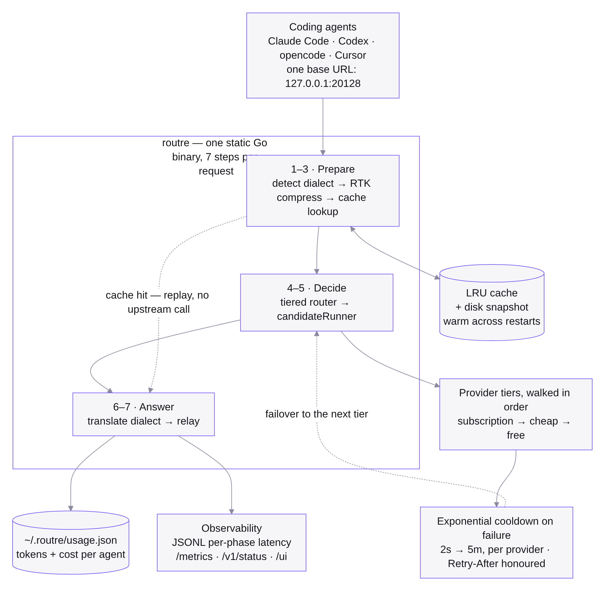
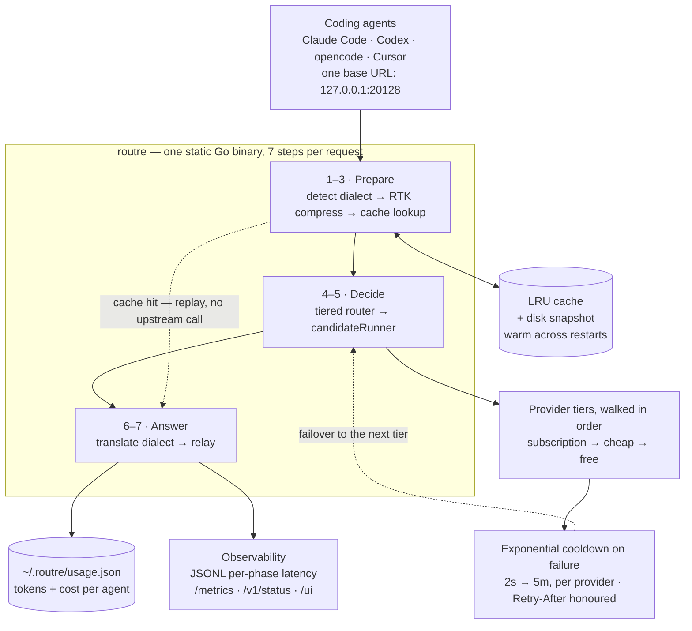
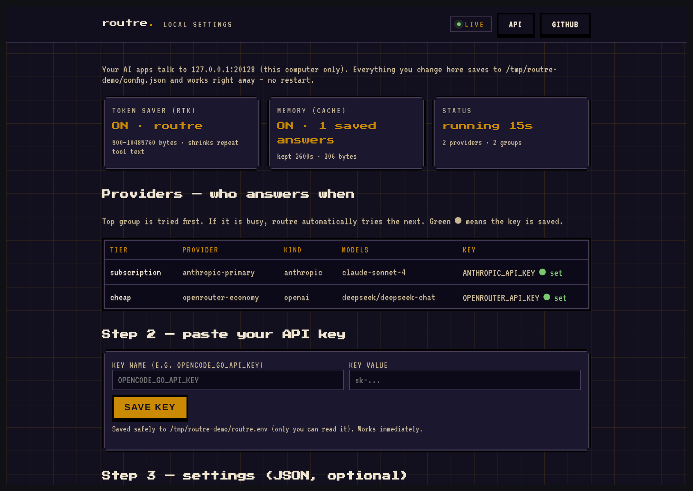

# Cutting Agent Token Bills by 94%: the Architecture of a Local LLM Gateway

> `routre` is one static Go binary that sits between your coding agents and every
> LLM provider. It compresses the tool output that dominates agent traffic,
> replays identical requests from cache, and fails over to the next provider when
> one is busy — while holding the API keys so the client never sees them.

| | |
| --- | --- |
| **Repository** | [github.com/mariobgsp/routre](https://github.com/mariobgsp/routre) |
| **Role** | Go backend & systems engineering |
| **Stack** | Go 1.26, standard library only — no Node, Python, Postgres or Redis |
| **Footprint** | ~10.6 MiB static binary, ~12.6 MiB idle RSS |
| **Verified** | Cloned, built and run locally (2026-10-17). Every screenshot and every number quoted as "observed" below comes from that run. |
| **Order** | 1 |

## At a glance

- **What it is** — a localhost reverse proxy for OpenAI/Anthropic-compatible AI
  APIs. Point `OPENAI_BASE_URL` or `ANTHROPIC_BASE_URL` at `127.0.0.1:20128`
  once, and every agent behind it gets failover, compression and caching for free.
- **Who it's for** — anyone running several coding agents (Claude Code, Codex,
  opencode, Cursor) who is paying per token and wants a per-agent ledger of where
  the money went.
- **The interesting part** — the gateway is a *pipeline*, not a load balancer.
  Seven ordered steps run on every request, and each one is bounded so it can
  never make the request slower than the provider would have been.

## The problem: agents are mostly tool output

An agent session is mostly not conversation. It is file reads, `grep` hits, test
logs, `git diff` output and directory listings, sent back to the model over and
over, largely the same shape every time. Three costs follow from that:

1. **You pay for repetition.** The same test log is billed again on the next turn.
2. **You pay for duplication.** Re-running a deterministic step resends a
   byte-identical request and buys a byte-identical answer a second time.
3. **You stop working when a provider does.** One provider hiccup is a failed
   agent run, unless something else is willing to answer.

`routre` addresses all three in the request path, at the point where the tokens
are actually billed, and it does it as a single local process rather than a
hosted service.

## What it does

| Capability | How |
| --- | --- |
| **RTK token compression** | 11 heuristic filters (git diff/log, grep, tree/ls/find, build output, smart truncate) applied to `tool_result` content before it is billed. Fail-open and *never* allowed to grow a payload. |
| **Response cache** | Exact match on the SHA-256 of the canonical JSON body *after* RTK. Streaming and non-streaming entries share a key space but never cross. |
| **Tiered failover** | Providers are grouped `subscription → cheap → free`; a failure moves to the next tier and puts the failed provider on an exponential cooldown (2 s → 5 min). |
| **Cross-dialect translation** | An OpenAI-shaped client can stream from an Anthropic provider and vice versa, via an in-flight SSE state machine. |
| **Token & cost ledger** | Per-agent (by `User-Agent`) requests, tokens in/out, RTK savings, cache savings and estimated cost, persisted to `~/.routre/usage.json`. |
| **Loopback dashboard** | `http://127.0.0.1:20128/ui` edits keys and the full config without hand-editing JSON. |
| **Key custody** | The gateway holds provider keys and injects them upstream; a client's `Authorization` header is a placeholder and is never forwarded. |

## Why this stack

| Layer | Choice | Why this — and not the obvious alternative |
| --- | --- | --- |
| Language | **Go, standard library only** | The whole product is *one file you drop on a machine*, with no runtime to install and no dependency tree to audit. LiteLLM and one-api are the obvious alternatives, and both mean running Python or Node with a database next to your agent. `go.mod` here has no `require` block at all. |
| Compression | **Deterministic heuristics, no model** | Shrinking tool output with a local LLM would add latency, a GPU or an API call, and non-determinism into the request path. Regex-and-shape filters are instant, testable, and can be *proven* fail-open. |
| Cache key | **Exact SHA-256 of the post-RTK body** | A semantic cache trades correctness for hit rate: a near-miss can serve the wrong answer to a deterministic run. Exact-match is boring and trustworthy. |
| Routing | **Static tiers from config** | Cost order is a policy decision, not an inference problem. Tiers are readable in `config.json`, and the routing rule is one sentence. |
| Dialect handling | **In-flight SSE state machine** | Buffering whole responses to translate them would break streaming and blow up memory on long generations. Frames are translated as they arrive. |
| Cache persistence | **gzip+gob snapshot** | Keeping the cache warm across restarts is worth a file; it is not worth a database. |
| Dashboard | **Embedded in the binary** | Shipping the settings page with the gateway means there is no second thing to run or version. |

## Architecture



<details>
<summary>Mermaid source (<code>diagrams/routre.mmd</code>)</summary>



</details>

### Component walkthrough

- **`internal/proxy/`** — the HTTP gateway and the seven-step pipeline. `runner.go`
  is the failover loop that decides when to retry, when to refresh a key, and when
  to give up.
- **`internal/proxy/dialect/`** — the cross-kind SSE state machine. This is what
  lets one address serve every OpenAI/Anthropic-compatible CLI.
- **`internal/rtk/`** — the 11 compression filters, each bounded by a 512 KiB scan
  window and a 150 ms budget.
- **`internal/cache/`** — the exact-match LRU plus the on-disk snapshot.
- **`internal/router/`** — tier walking, per-provider cooldown and model discovery.
- **`internal/usage/`** — the ledger that records what RTK and the cache saved.
- **`internal/config/`** — `config.json` + the `0600` `routre.env` for secrets,
  reloadable with `SIGHUP`.

### One request, end to end

1. **Detect dialect** — probe the path and body to decide whether the caller
   speaks OpenAI, Anthropic or the Responses API, and normalise the request.
2. **RTK compress** — shrink `tool_result` bodies. If a filter cannot help, the
   payload passes through unchanged; compression strictly never enlarges it, and
   work stops at the scan window or the time budget rather than delaying the call.
3. **Cache lookup** — hash the canonical post-RTK JSON and look for the same
   request. A hit replays the stored response byte-for-byte with no upstream call,
   which is why the second request in my run returned in ~2 ms.
4. **Route** — walk tiers in config order and pick the cheapest *healthy*
   provider. A provider that just failed is held back by a cooldown rather than
   retried forever.
5. **Retry / failover** — one immediate connection-level retry, one free auth
   refresh on `401/403`, then move to the next candidate. Once a first byte has
   been emitted, failover is disabled — the gateway would rather fail than
   duplicate output into a stream your tool has already half-read.
6. **Translate dialect** — rewrite the upstream event stream into the dialect the
   caller asked for. Tool-call ids round-trip unchanged so agent tool loops keep
   working across providers.
7. **Relay** — stream the answer home, record per-phase latency and update the ledger.

## Architecture decisions worth defending

**Bounded, fail-open compression instead of aggressive compression.**
Every filter must return something no larger than it received, and the whole stage
stops at 150 ms. *Cost:* some payloads that a slower algorithm could compress are
left alone. *Benefit:* compression can never be the reason a request fails or
takes longer than the model itself.

**Exact-match caching instead of semantic caching.**
*Cost:* the hit rate is lower than a fuzzy cache. *Benefit:* a hit is provably the
same request, so a deterministic run cannot be poisoned by a near-miss. Streaming
and non-streaming responses get separate entries even under the same key space, so
a saved stream is never spliced into a JSON call.

**Failover bounded by a budget, not by an attempt count.**
Each candidate gets a soft slice (45 s by default), bounded by the whole-request
budget while providers remain, and one adaptive 45 s extension when the socket is
demonstrably alive. *Cost:* a client can observe a request running past the soft
slice. *Benefit:* a slow-but-healthy provider is no longer converted into a 503 at
an arbitrary deadline — the repo explains that this exact case ("provider answered
at 27 s, gateway gave up at 30 s") is why the extension exists.

**Honest error identity.** `model_not_found` is returned only when no configured
provider can serve the model. When every provider that *could* serve it is cooling
down, the answer is `providers_unavailable` with a `Retry-After` header, because
the remedy is waiting, not editing config.

**Loopback-first security.** The gateway binds `127.0.0.1` and the dashboard
rejects non-loopback `Host`/`Origin` headers (DNS-rebinding and CSRF mitigation).
An optional shared secret covers shared machines. Keys live in a `0600` file, not
in the JSON config.

## Running it

```bash
# build from source (no dependencies to fetch)
git clone https://github.com/mariobgsp/routre && cd routre
make build                      # or: CGO_ENABLED=0 go build -trimpath -ldflags "-s -w" -o routre .
./routre version

# configure and start
./routre setup                  # writes config.json + routre.env (0600)
./routre serve                  # gateway on 127.0.0.1:20128
curl http://127.0.0.1:20128/healthz

# point any agent at it
export OPENAI_BASE_URL=http://127.0.0.1:20128
export ANTHROPIC_BASE_URL=http://127.0.0.1:20128
```

To reproduce the screenshots below without spending money, `tools/capture/routre-demo.sh`
in this repository builds the binary and the repo's own `cmd/mock-upstream`, wires
two tiers (one unreachable, one mocked), sends a tool-heavy request twice, and
prints the ledger.

### What I observed

The demo sends one request containing a realistic, highly repetitive `git diff`
plus a test log (≈40 KB of tool output), then sends the identical request again:

```text
— request 1 (cache miss: tier-1 fails over, RTK compresses) —
HTTP/1.1 200 OK
X-Llrouter-Cache: miss
X-Llrouter-Provider: openrouter-economy      ← tier 1 was unreachable, so it failed over

— request 2 (identical: replayed from cache) —
HTTP/1.1 200 OK
X-Llrouter-Cache: hit
```

```text
== live gateway ==
  anthropic-primary up
  openrouter-economy up

== token & cost ledger ==
  opencode
    requests: 2
    consumed: 15 tokens (10 in + 5 out)
    saved:    9643 tokens (rtk 9633 + cache 10)
    cost:     $0.000009   saved: $0.002890
```

Two things are worth separating in that output:

- The **cache hit** and the **failover** are architectural facts I can reproduce
  on demand: the second request never reached a provider, and the first one
  reached the *second* tier because the first one failed.
- The **99.8% saving on that run** is a property of my deliberately repetitive
  fixture, not a general number. The figure that belongs in a headline is the one
  the repository gates in CI: **94.8% aggregate / 93.3% worst-payload tool-token
  reduction**, measured by `make bench` and *failing the build* below 90%. And it
  applies to tool-result tokens only — output tokens are never compressed.

## Screenshots



*The embedded local dashboard: compression and cache state, the provider tier
table, and key presence. Captured against the repo's mock upstream, so no real
provider keys or spend are involved — the tier names are a plausible config, the
traffic is local.*

The equivalent CLI view of the same state, one line per concern:

```text
== configured providers ==
  [subscription] anthropic-primary   anthropic key ok  models=claude-sonnet-4      $3.0000/M in, $15.0000/M out
  [cheap]        openrouter-economy  openai    key ok  models=deepseek/deepseek-chat $0.3000/M in, $1.2000/M out
```

## What I'd fix next

- **Non-streaming `openai → anthropic` translation is missing.** The streaming
  path handles all pairs, but a non-streaming Anthropic client routed to an OpenAI
  provider currently gets the raw OpenAI body. The repo knows: `tests/e2e_test.go`
  pins the gap so a fix is caught.
- **Token estimates are approximations** (≈4 bytes/token), which is fine for a
  benchmark instrument and wrong for billing. Real BPE counts already exist for
  payloads under 64 KiB; extending that would make the ledger exact.
- **Windows self-update is deferred** — `routre update` prints a re-install hint
  instead of replacing the running executable.

## Links

- **Source:** [github.com/mariobgsp/routre](https://github.com/mariobgsp/routre)
- **Internals:** [`docs/HOW-IT-WORKS.md`](https://github.com/mariobgsp/routre/blob/main/docs/HOW-IT-WORKS.md)
- **Releases:** [latest](https://github.com/mariobgsp/routre/releases/latest)
- **Changelog:** [`CHANGELOG.md`](https://github.com/mariobgsp/routre/blob/main/CHANGELOG.md)

---

*Article and images generated from the repository as it stands at commit
`849ad95` (2026-10-10). Diagram source: [`diagrams/routre.mmd`](diagrams/routre.mmd).
Capture script: [`tools/capture/routre-demo.sh`](tools/capture/routre-demo.sh),
[`tools/capture/routre.mjs`](tools/capture/routre.mjs).*
