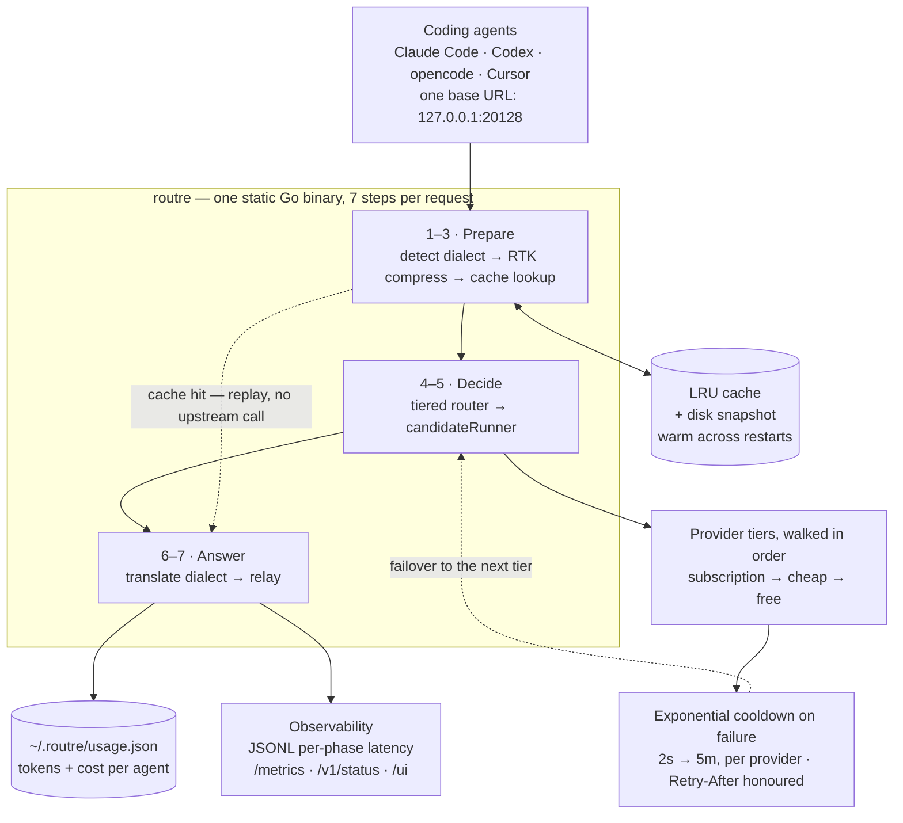

# A Local LLM Gateway That Cuts Agent Token Bills

> `routre` is one static Go binary between your coding agents and every LLM
> provider. It compresses the tool output that dominates agent traffic, replays
> identical requests from cache, and fails over to the next provider when one is
> busy — while holding the API keys so the client never sees them.

| | |
| --- | --- |
| **Repository** | [github.com/mariobgsp/routre](https://github.com/mariobgsp/routre) |
| **Role** | Go backend & systems engineering |
| **Stack** | Go 1.26, standard library only — no Node, Python, Postgres or Redis |
| **Footprint** | ~10.9 MiB static binary, ~12.6 MiB idle RSS |
| **Verified** | Re-read against commit `849ad95` (2026-10-25). Screenshots and demo output are from the 2026-10-17 run. |
| **Order** | 1 |

## At a glance

- **What it is** — a localhost reverse proxy for OpenAI- and
  Anthropic-compatible APIs. Point `OPENAI_BASE_URL` or `ANTHROPIC_BASE_URL` at
  `127.0.0.1:20128` once, and every agent behind it gets failover, compression
  and caching for free.
- **Who it's for** — anyone running several coding agents (Claude Code, Codex,
  opencode, Cursor) who pays per token.
- **The interesting part** — the gateway is a *pipeline*, not a load balancer.
  Seven steps run on every request, and each one is bounded so it cannot make a
  request slower than the provider would have been.

## The problem

Agent sessions are mostly tool output — file reads, `grep` hits, test logs,
diffs — sent back to the model over and over. Three costs follow.

1. **You pay for repetition.** The same test log is billed again on the next turn.
2. **You pay for duplication.** A byte-identical request buys a byte-identical
   answer a second time.
3. **You stop working when a provider does.** One provider hiccup becomes a
   failed agent run unless something else can answer.

`routre` fixes all three at the point where tokens are billed.

## What it does

| Capability | How |
| --- | --- |
| **Compress tool output** | 11 heuristic filters for diffs, grep, trees, build logs and long output, applied to `tool_result` content. Fail-open; a payload never grows. |
| **Replay exact requests** | SHA-256 of the canonical body *after* compression. Streaming and non-streaming entries never cross. |
| **Fail over by tier** | Providers are grouped `subscription → cheap → free`; a failure moves down a tier and cools the failed provider down (2 s to 5 min). |
| **Translate dialects** | An OpenAI client can stream from Anthropic, and the reverse, via an in-flight SSE state machine. |
| **Track tokens and cost** | Per-agent requests, tokens, compression and cache savings, and estimated cost, persisted to `~/.routre/usage.json`. |
| **Keep control local** | A loopback dashboard edits keys and config. Keys live in a `0600` env file; a client's `Authorization` header is never forwarded. |

## How it works


<details>
<summary>Mermaid source (<code>diagrams/routre.mmd</code>)</summary>



</details>

### Components

- **`internal/proxy/`** — the HTTP gateway and the seven-step pipeline.
  `runner.go` is the failover loop: when to retry, when to refresh a key, when
  to give up.
- **`internal/proxy/dialect/`** — the SSE state machine that lets one address
  serve OpenAI and Anthropic clients.
- **`internal/rtk/`** — the 11 compression filters, bounded by a 512 KiB scan
  window and a 150 ms budget.
- **`internal/cache/`** — the exact-match LRU plus the on-disk snapshot.
- **`internal/router/`** — tier walking, per-provider cooldown and model
  discovery.
- **`internal/usage/`** and **`internal/config/`** — the savings ledger and the
  reloadable `config.json` + `routre.env` pair.

### One request, end to end

1. **Detect the dialect.** Read the path and body to decide whether the caller
   speaks OpenAI, Anthropic or the Responses API, then normalise the request.
2. **Compress.** Shrink `tool_result` bodies; if a filter cannot help, the
   payload passes through unchanged, and work stops at the scan window or the
   time budget rather than delaying the call.
3. **Look up the cache.** Hash the canonical post-compression body. A hit replays
   the stored response byte for byte with no upstream call — in my run, the
   second request returned in 2 ms.
4. **Route and retry.** Pick the cheapest healthy provider, try one
   connection-level retry and one free auth refresh on `401/403`, then move on.
   Once a first byte has been emitted, failover stops rather than duplicate
   output into a half-read stream.
5. **Translate and relay.** Rewrite the upstream stream into the caller's dialect,
   record latency, and update the ledger.

## Key choices

| Choice | Why | Cost |
| --- | --- | --- |
| **Bounded, fail-open compression** | Every filter must return something no larger than it received, and the stage stops at 150 ms. Compression can never be the reason a request fails. | Some payloads a slower algorithm could shrink are left alone. |
| **Exact-match caching** | A hit is provably the same request, so a deterministic run cannot be poisoned by a near-miss. | A lower hit rate than a fuzzy or semantic cache. |
| **Failover bounded by a budget** | Each provider gets a 45 s soft slice inside the request budget, plus one 45 s extension when the socket is alive. | A client can see a request run past the soft slice. |
| **Loopback-first security** | Bind `127.0.0.1`; reject non-loopback `Host`/`Origin` headers; keep keys in a `0600` file. | Not designed for a shared or public network. |

## Running it

```bash
git clone https://github.com/mariobgsp/routre && cd routre
make build
./routre version

./routre setup                  # writes config.json + routre.env (0600)
./routre serve                  # gateway on 127.0.0.1:20128
curl http://127.0.0.1:20128/healthz

export OPENAI_BASE_URL=http://127.0.0.1:20128
export ANTHROPIC_BASE_URL=http://127.0.0.1:20128
```

### What I observed

```text
request 1:  X-Llrouter-Cache: miss   X-Llrouter-Provider: openrouter-economy
request 2:  X-Llrouter-Cache: hit

ledger:  2 requests · 15 tokens used · 9,643 saved (9,633 RTK + 10 cache)
```

Two facts are reproducible: the second request never reached a provider, and
the first reached the second tier because the first failed. The 99.8% saving
comes from a deliberately repetitive fixture. The headline is the CI-gated
**94.8% aggregate and 93.3% worst-payload tool-token reduction**, measured by
`make bench`, failing below 90%. It applies to tool-result tokens only.

## Screenshots


*The embedded dashboard: compression and cache state, provider tiers, and key
presence. Captured against the mock upstream, so no real keys or spend are
involved.*

## What I'd fix next

- **Non-streaming `openai → anthropic` translation is missing.** Streaming
  handles every pair, but a non-streaming Anthropic client routed to an OpenAI
  provider gets the raw OpenAI body. `tests/e2e_test.go` pins the gap.
- **Token estimates are approximations** (about 4 bytes per token): fine for a
  benchmark, wrong for billing. Real BPE counts already exist for payloads under
  64 KiB.
- **Windows self-update is deferred.** `routre update` prints a re-install hint
  instead of replacing a running executable.

## Links

- **Source:** [github.com/mariobgsp/routre](https://github.com/mariobgsp/routre)
- **Internals:** [`docs/HOW-IT-WORKS.md`](https://github.com/mariobgsp/routre/blob/main/docs/HOW-IT-WORKS.md)
- **Releases:** [latest](https://github.com/mariobgsp/routre/releases/latest)
- **Changelog:** [`CHANGELOG.md`](https://github.com/mariobgsp/routre/blob/main/CHANGELOG.md)

---

*Verified against commit `849ad95` (2026-10-25). Diagram source:
[`diagrams/routre.mmd`](diagrams/routre.mmd). Capture script:
[`tools/capture/routre-demo.sh`](tools/capture/routre-demo.sh),
[`tools/capture/routre.mjs`](tools/capture/routre.mjs).*
