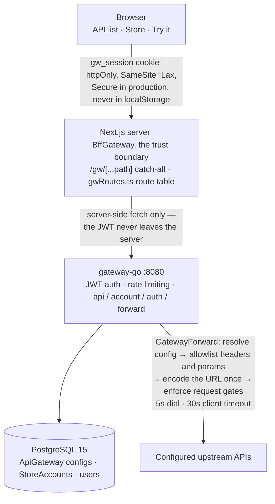

# An API Gateway That Keeps JWTs Out of the Browser

> The Gateway is a small API-management console: define the upstream APIs you
> call, allowlist what may reach them, and test them from the UI. The interesting
> part is not the CRUD. It is that the session token never becomes readable by a
> single line of browser JavaScript.

| | |
| --- | --- |
| **Repository** | [github.com/mariobgsp/the-gateway](https://github.com/mariobgsp/the-gateway) |
| **Role** | Backend (Go) + full-stack engineering |
| **Stack** | Next.js 15 (BFF) · Go 1.26 + chi + pgx · PostgreSQL 15 · Docker Compose / Kubernetes |
| **Verified** | Re-read against `82acad0` (2026-10-25; tooling-only). Screenshots from the 2026-10-17 run. |
| **Order** | 5 |

## At a glance

- **What it is** — a control plane for outbound HTTP APIs plus a runtime that
  executes them. Each `ApiGateway` record stores the host, path, method, header and
  parameter allowlists, and a required-body gate.
- **Who it's for** — teams that call many third-party APIs and want one place to
  see, constrain and test them without exposing a credential to the browser.
- **The interesting part** — the trust boundary is the **Next.js server**, not the
  SPA. Every backend call is a server-side fetch behind an `httpOnly` cookie, and
  every upstream call re-enforces the allowlists in the database.

## The problem

Most SPA-plus-API projects end up with two problems.

**1 — The token is readable by any script on the page.** A JWT in `localStorage`
means one injected script or compromised dependency is a full account takeover.

**2 — Any URL the browser can name, the server will fetch.** A gateway that
forwards whatever path, header or query it is handed is an open proxy. An attacker
can reach unconfigured hosts, leak credentials, or use your service as an SSRF
pivot.

This project answers both by construction: the browser holds an opaque cookie it
cannot read, and the Go service derives the outbound request from *persisted
configuration*, not the incoming request.

## What it does

| Capability | How |
| --- | --- |
| **Upstream API registry** | Named `ApiGateway` records: identifier, host, path, method, allowlists, body gate, status. |
| **Store accounts** | Machine principals with a client id and secret, tied to a user. |
| **Server-side session** | Login mints a JWT into an `httpOnly`, `SameSite=Lax` cookie, `Secure` in production. The browser never reads it. |
| **Guarded forwarding** | `GatewayForward` resolves the stored config, filters headers and parameters, encodes the URL once, enforces the body gate, then calls upstream. |
| **Try-it console** | Run a configured API from the UI and see the raw upstream response. |
| **Envelope contract** | One shape: `code: "00"` is success; other codes name specific faults. |
| **Two deploy paths** | Docker Compose locally, Kubernetes manifests for a cluster. |

## How it works


<details>
<summary>Mermaid source (<code>diagrams/the-gateway.mmd</code>)</summary>



</details>

### Components

- **`frontend/src/app/gw/[...path]/route.ts`** — the catch-all HTTP adapter.
  Every browser-to-backend call enters here.
- **`frontend/src/lib/bffGateway.ts`** — `BffGateway` owns session lookup, the
  unauthorized response, the backend fetch, the timeout and envelope translation.
  Sanitisation is private, so no call site can forget it.
- **`frontend/src/lib/gwRoutes.ts`** — the declarative route table that maps
  `/gw/*` paths onto backend paths.
- **`gateway-go/internal/handler/`** and **`internal/service/forward.go`** — the
  router, auth middleware and `ForwardRequest`, the typed seam that keeps
  forwarding policy testable without a socket.
- **`gateway-go/internal/store/`** and **`internal/api/`** — one file per entity
  over a shared Postgres connection, plus the envelope and its error codes.

### One browser click, end to end

1. The page calls a literal `/gw/...` path; no user-constructed URL reaches the
   fetch sink.
2. `gwRoutes.ts` matches the path and resolves the backend path.
3. `BffGateway` reads the `gw_session` cookie. If missing or invalid, it returns an
   envelope error without calling the backend.
4. The server-side fetch runs with the JWT in `Authorization`, under a timeout and
   `AbortController`.
5. `gateway-go` authenticates the JWT and loads the stored `ApiGateway` record.
6. `GatewayForward` builds the URL from the stored host and path, filters headers
   and query parameters down to the allowlists, enforces the body gate, and calls
   upstream.
7. The upstream response is mapped into the envelope, then mapped once more for the
   browser.

## Key choices

| Choice | Why | Cost |
| --- | --- | --- |
| **Next.js server as the trust boundary** | The token must live where the browser cannot read it; the BFF is already there for the UI. | Every backend call costs a server round-trip; the BFF is another deployment unit. |
| **`httpOnly` + `SameSite=Lax` cookie** | Removes the token from JavaScript; the cookie policy provides CSRF protection. | The server must set `COOKIE_SECURE` correctly behind TLS. |
| **Allowlists enforced twice** | The BFF sanitises what it forwards; the Go service re-derives the request from persisted config. | A header allowed in config but stripped by the BFF fails confusingly. |
| **Encode the URL exactly once** | Tolerant query parsing; canonical encoding in one place (`service.BuildForwardURL`). | Callers must know the tolerant-parse policy. |
| **One envelope for every fault** | One UI error path; stable, documentable codes. | An extra translation step for upstream bodies. |

## Running it

```bash
cd project && docker compose up -d postgres
psql "$DATABASE_URL" -f project/pg-init-scripts/gateway.sql

docker compose up -d --build          # postgres + gateway-go (8080) + frontend (3000)

cd gateway-go && go build ./... && go vet ./... && go test ./...
cd frontend   && npm run lint && npm run typecheck && npm test && npm run build
```

### What I observed

After login, from inside the page:

```text
document.cookie => ""
session cookie  => gw_session httpOnly=true sameSite=Lax
BFF 200 /gw/auth/login
BFF 200 /gw/apis
```

The cookie exists and every backend call went through the BFF, yet
`document.cookie` is empty: the token is unreadable.

The Try-it console also surfaced an environment fact: a public upstream failed
with `x509: certificate signed by unknown authority` because the container lacked
this network's intercepting CA. The gateway returned the real error instead of a
generic 500; an internal endpoint completed the round trip.

## Screenshots


*The API list: name, identifier, method badge and lifecycle status.*


*One API's configuration; the lower row is the security surface.*


*The Try-it console issues a real request through the whole pipeline.*

## What I'd fix next

- **The schema is a separate step.** Compose mounts the init SQL, but a native
  run needs `psql -f` before the UI has anything to show. A boot migration or a
  "0 APIs configured" readout would explain a first run.
- **`test:e2e` uses port 3001** to avoid a local dev server; a busy port makes a
  run appear to hang.
- **`COOKIE_SECURE` must be `true` behind TLS.** The Compose file sets it to
  `false` for local HTTP, correct locally and wrong anywhere else.
- **Forwarding inherits the host's CA trust**; a slim container store rejects
  upstreams the host accepts.

## Links

- **Source:** [github.com/mariobgsp/the-gateway](https://github.com/mariobgsp/the-gateway)
- **Tech-stack notes:** [`specs/tech-architecture/tech-stack.md`](https://github.com/mariobgsp/the-gateway/blob/main/specs/tech-architecture/tech-stack.md)
- **Agent guide:** [`CLAUDE.md`](https://github.com/mariobgsp/the-gateway/blob/main/CLAUDE.md)

---

*Verified against commit `82acad0` (2026-10-25). Diagram source:
[`diagrams/the-gateway.mmd`](diagrams/the-gateway.mmd). Capture script:
[`tools/capture/the-gateway.mjs`](tools/capture/the-gateway.mjs).*
