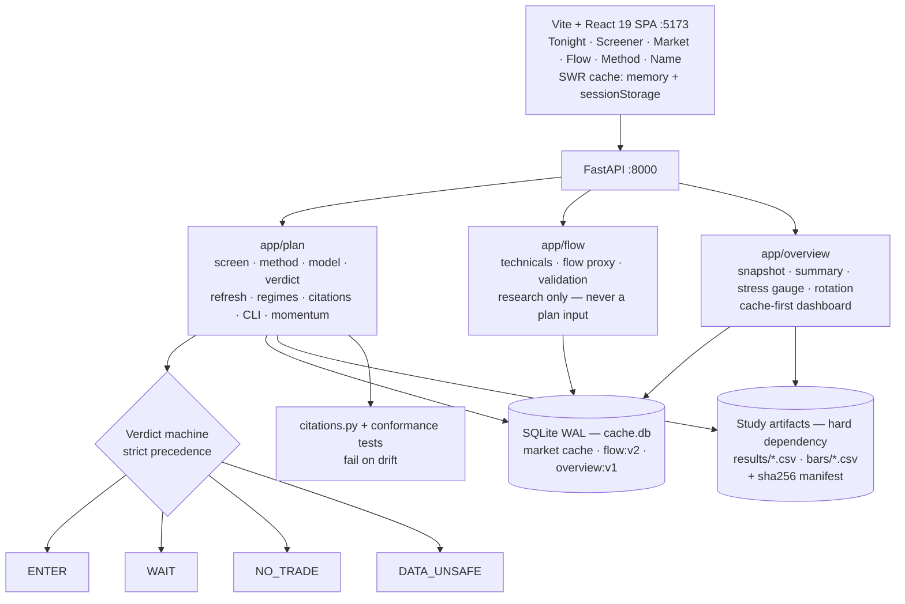

# A Stock Screener That Refuses to Buy

> Most screeners answer with a list. This one answers with a verdict, the measured
> evidence behind it, and often no. Six screens, a FastAPI backend and a data
> check that outranks every signal.

| | |
| --- | --- |
| **Repository** | [github.com/mariobgsp/trading-suite](https://github.com/mariobgsp/trading-suite) |
| **Role** | Backend engineering, quantitative research tooling, data integrity |
| **Stack** | Python 3.11+ + FastAPI · SQLite (WAL) · Vite + React 19 + TanStack Router · yfinance / IDX |
| **Verified** | Re-read against commit `e1a314a` (2026-10-25). The `DATA_UNSAFE` output below is from the 2026-10-17 run. |
| **Order** | 3 |

## At a glance

- **What it is** — a self-hosted desk for the Indonesian market (IDX). Six screens
  and a CLI read a walk-forward study's artifacts, apply its rule chain to live
  bars, and answer one question per session: *what should I buy at the next open,
  and why* — or why not.
- **Who it's for** — one person or a small team who wants their own copy of the
  analysis, and would rather see an honest "no" than a fabricated "yes".
- **The interesting part** — the product is the **refusal**. `NO_TRADE` and
  `DATA_UNSAFE` are first-class outcomes with more engineering behind them than
  the `ENTER` path, and every quoted number is traceable to the study that
  produced it.

## The problem

Three failure modes make most screeners worse than useless.

1. **A list is not a decision.** Ranked tickers with no entry, stop, size or
   horizon leave the reader to invent the part that determines the outcome.
2. **Backtested numbers are quoted as maxima.** "78% win rate" usually means the
   best cell found in a search of thousands, not what the next trade should be
   expected to do.
3. **Broken data still produces a signal.** A stale bar, a phantom session or a
   half-finished candle silently becomes a buy recommendation.

This suite uses the opposite defaults: a verdict instead of a list, the corrected
result next to the searched maximum, and an integrity gate that fails closed.

## What it does

| Screen or command | The question it answers |
| --- | --- |
| **Tonight** (`/`) | Should I buy anything, and what exactly? The verdict, each ticket, the watchlist, and the case for standing down. |
| **Screener** (`/screener`) | Every name, ranked by how near it is to being buyable — with no buy signals, on purpose. |
| **Market** (`/market`) | The daily dashboard: breadth, the stress gauge, and weekly sector, conglomerate and industry rotation. |
| **Flow** (`/flow`) | Technical cards and a transparent flow-pressure proxy. A research panel, not a plan input. |
| **Method** (`/method`) | The rule chain, the corrected result, the horizons that were measured and refused, the costs, and every citation. |
| **Name** (`/name/$ticker`) | One name: each condition and how long it has held, the run-up, levels, ticket and chart. |
| **CLI** | `./trading-suite plan`, `plan momentum`, `plan name TICKER`, `plan method`, `plan size` — the same engine without a browser. |

One verdict is produced per session, in strict precedence: `ENTER` → `WAIT` →
`NO_TRADE` → `DATA_UNSAFE`. Six integrity checks — exchange calendar, bars
current, universe size, coverage, phantom bars, evidence readable — must all pass
before a ticket appears.

## How it works


<details>
<summary>Mermaid source (<code>diagrams/trading-suite.mmd</code>)</summary>



</details>

### Components

- **`backend/app/plan/`** — the nightly method: `screen`, `method`, `model`,
  `verdict`, `refresh`, `regimes`, `citations`, `bars`, plus the new `cli`
  and `momentum` modules.
- **`backend/app/flow/`** — technical cards and a causal flow-pressure proxy,
  deliberately outside the plan: the verdict cannot depend on it.
- **`backend/app/overview/`** — the Market dashboard. A background job builds one
  snapshot, and `GET /api/overview` only reads it; a warm request is a SQLite read,
  not a universe scan.
- **`backend/app/computed_cache.py`** — the shared versioned SQLite cache for
  computed payloads (`flow:v2:*`, `computed:overview:v1:*`).
- **`backend/app/routers/`** and **`frontend-web/src/routes/`** — thin HTTP and
  UI seams. All plan screens read the same engine.

### One session, end to end

1. **Load bars.** Resolve the source — study CSVs, else live — and read the
   benchmark first, because the index is the exchange calendar the ticker files are
   validated against.
2. **Drop phantom bars.** Sessions the exchange never held are removed and counted,
   not silently accepted.
3. **Apply the market gate.** Breadth is the share of the universe above its own
   200-session average; the index's own stage comes next.
4. **Run the rule chain.** A 40-session breakout, relative strength in the top 10%,
   and 20-session volatility in its own lowest 40%.
5. **Check integrity.** Any failed check short-circuits to `DATA_UNSAFE` and
   withholds every ticket.
6. **Produce one verdict and attach the evidence.** The corrected headline, the
   searched maximum labelled as a maximum, the haircuts, and the citation for each
   quoted figure.

## Key choices

| Choice | Why | Cost |
| --- | --- | --- |
| **Refusal is a product state** | The screener can show no buy signals, and the flat band is a documented finding. The app cannot manufacture a recommendation to look useful. | A user who wants a hot list daily gets an empty screen. |
| **`DATA_UNSAFE` outranks every signal** | Integrity checks fail closed and suppress all output, with no warning that can sit beside a ticket. | One bad ticker file can blank the whole session. |
| **Evidence tiers are never blended** | The searched census, the walk-forward corrected row and the one-window replay are shown as three distinct things, each labelled. | The headline is less impressive than the maximum. |
| **The study stays the source of truth** | Live bars are merged in memory, never written back; Market caches a snapshot, but the study remains immutable. | A cold start repeats the merge, and the study checkout is a hard dependency. |

## Running it

```bash
git clone https://github.com/mariobgsp/trading-suite && cd trading-suite

# backend
cd backend && python -m venv .venv && .venv/bin/pip install -r requirements.txt && cd ..
# frontend
cd frontend-web && npm install && cd ..

./trading-suite run        # backend :8000 + frontend :5173
./trading-suite plan       # tonight's verdict in the terminal
./trading-suite plan momentum
./trading-suite verify     # backend tests + frontend typecheck
```

The plan and Market read the study at `TRADING_DOCS_DIR` (default
`~/Projects/trading-backtest-docs`); Flow uses the app's own feeds.

### What I observed

The study checkout is private, so I supplied a stand-in built by
`tools/capture/make-study-stub.py`: **real daily bars** for 22 names, a real
manifest, and **no `results/*.csv`**. The absence is the experiment. The app
answered:

```json
{
  "state": "DATA_UNSAFE",
  "action": "Do not trade. Fix the data or the evidence first.",
  "primary_blocker": {
    "key": "universe",
    "text": "21 names traded above their own 200-day average (floor 100)."
  }
}
```

Six checks were evaluated: four passed and two failed.

```text
✓ exchange session calendar          last session: 2026-10-16
✓ bars reach the last session        bars end 2026-10-16
✗ universe is big enough             21 names (floor 100)
✓ coverage                           22 of 21 names have a bar (105%, floor 60%)
✓ no off-calendar bars               0
✗ measured row readable              results unreadable
```

That is the thesis in one screen: a 9.5% breadth reading against a 60%
requirement, a capitulation band, real prices — and no ticket, because the
evidence under it is incomplete. The repository's latest full run reports **248
backend tests passed, 6 skipped**.

## Screenshots


*Tonight: the verdict, the action, and the six integrity checks that produced it.*


*The Screener on purpose: each row shows how near a name is to qualifying, not a
signal.*


*One name: every condition, its value, its threshold, and the distance between
them.*

## What I'd fix next

- **A missing study checkout returns HTTP 500 instead of `DATA_UNSAFE`.**
  `default_source()` falls back to `LiveBars`, but the loader calls
  `source.load(None)` and `LiveBars.load()` expects a list, so the request raises
  `TypeError` before the verdict can fail closed.
- **The Method screen has no error state.** A failed request leaves "Loading the
  method…" on screen forever, so a slow load and a dead one look the same.
- **The deployment leftovers are stale.** `docker-compose.yml` and the root
  `Dockerfile` still build the removed Next.js frontend; the PlantUML docs describe
  an earlier five-route desk.
- **Flow is a proxy, not the vendor's Liquidity Pressure Model.** The formula and
  its data are proprietary. The UI says "proxy" and reports the proxy's
  forward-return record, not a parity claim.

## Links

- **Source:** [github.com/mariobgsp/trading-suite](https://github.com/mariobgsp/trading-suite)
- **Plan module:** [`backend/app/plan/README.md`](https://github.com/mariobgsp/trading-suite/blob/main/backend/app/plan/README.md)
- **Flow module:** [`backend/app/flow/README.md`](https://github.com/mariobgsp/trading-suite/blob/main/backend/app/flow/README.md)
- **Market module:** [`backend/app/overview/README.md`](https://github.com/mariobgsp/trading-suite/blob/main/backend/app/overview/README.md)

---

*Verified against commit `e1a314a` (2026-10-25). Diagram source:
[`diagrams/trading-suite.mmd`](diagrams/trading-suite.mmd). Capture scripts:
[`tools/capture/trading-suite.mjs`](tools/capture/trading-suite.mjs),
[`tools/capture/make-study-stub.py`](tools/capture/make-study-stub.py).*
