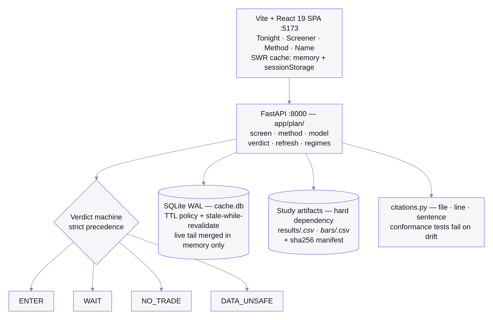
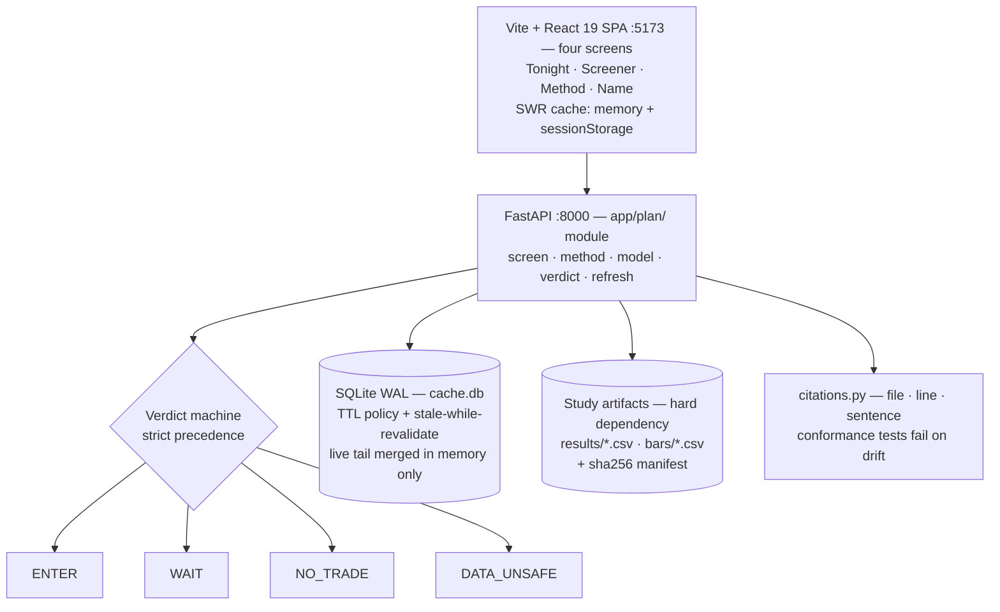
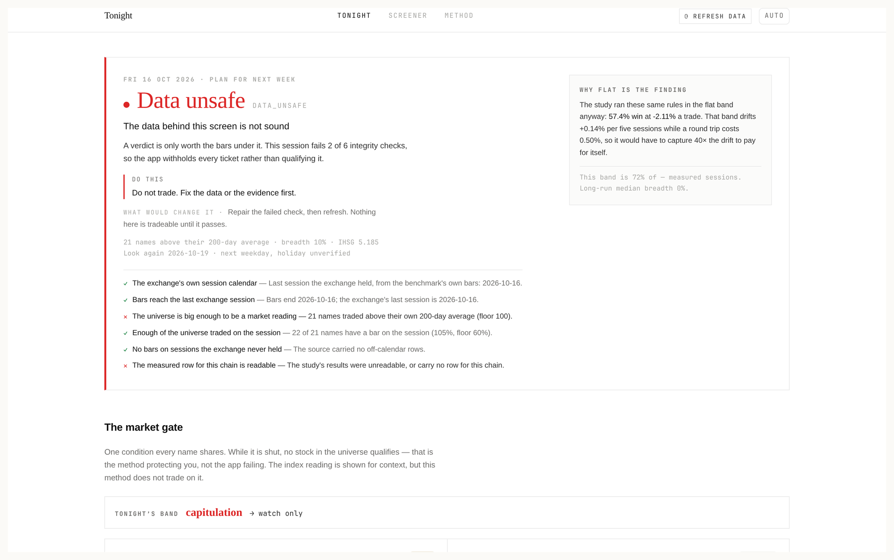
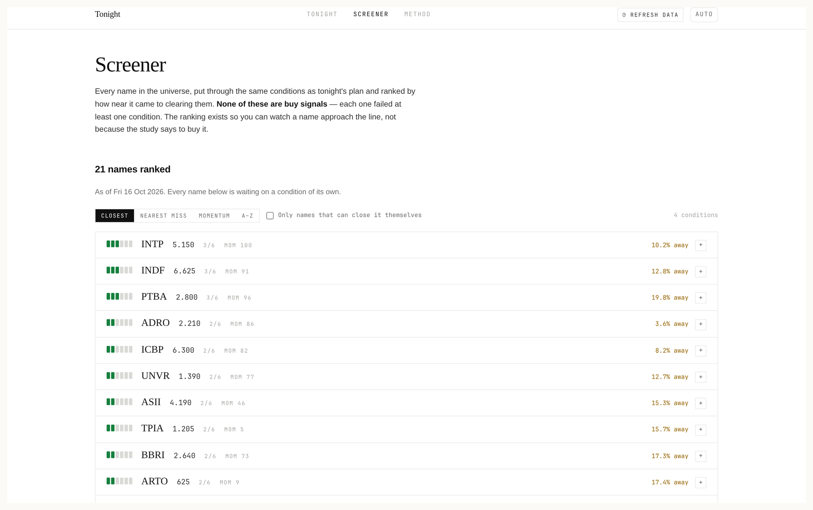
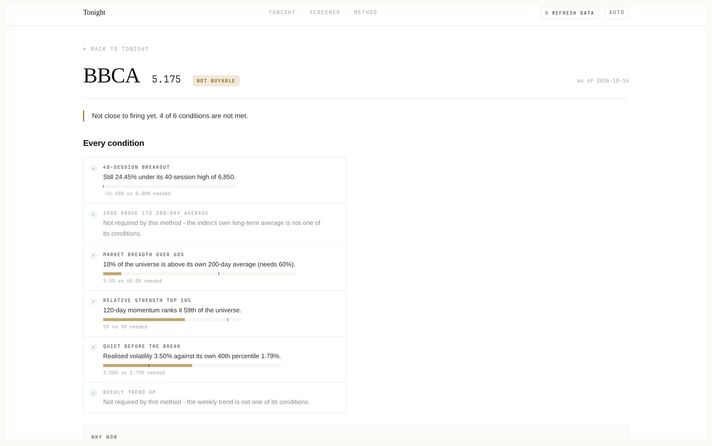

# The Screener That Refuses to Buy: Engineering Honesty Into an IDX Market Desk

> Most screeners answer "here is a list". This one answers "here is the list, the
> measured evidence behind it, and — often — no". Four screens, a FastAPI
> backend, and a verdict that withholds every ticket when the data underneath it
> is not sound.

| | |
| --- | --- |
| **Repository** | [github.com/mariobgsp/trading-suite](https://github.com/mariobgsp/trading-suite) |
| **Role** | Backend engineering, quantitative research tooling, data integrity |
| **Stack** | Python 3 + FastAPI · SQLite (WAL) · Vite + React 19 + TanStack Router · yfinance / IDX |
| **Verified** | Built and run locally (2026-10-17). The verdict quoted below is the app's own output on my run. |

## At a glance

- **What it is** — a self-hosted desk for the Indonesian market (IDX). It reads a
  walk-forward study's own artifacts, applies that study's rule chain to live
  bars, and answers one question per session: *which Indonesian stocks should be
  bought at the next open, and why* — or why not.
- **Who it's for** — one person or a small team who wants their own copy of the
  analysis instead of a subscription, and who would rather see an honest "no"
  than a fabricated "yes".
- **The interesting part** — the product is the **refusal**. Ticket-withheld
  states (`NO_TRADE`, `DATA_UNSAFE`) are first-class outcomes with more
  engineering behind them than the `ENTER` path, and the evidence is traceable
  line-by-line back to the study that produced it.

## The problem: a screener that always finds something

Three failure modes make most retail screeners worse than useless:

1. **A list is not a decision.** Ranked tickers with no entry, stop, size or
   horizon leave the reader to invent the part that determines the outcome.
2. **Backtested numbers are quoted as maxima.** "78% win rate" usually means "the
   best cell we found in a search of thousands" — not what the next trade should
   be expected to do.
3. **Broken data still produces a signal.** A stale bar, a phantom session or a
   half-finished candle silently becomes a buy recommendation.

This suite is built around the opposite defaults: a verdict instead of a list, the
*corrected* result next to the searched maximum, and a data-integrity gate that
outranks every signal.

## What it does

| Screen | The question it answers |
| --- | --- |
| **Tonight** (`/`) | Should I buy anything, and if so what exactly? The verdict, the ticket for each name, the watchlist, and the measured case for standing down. |
| **Screener** (`/screener`) | Every name, ranked by how near it is to being buyable — with no buy signals, on purpose. |
| **Method** (`/method`) | The rule chain, the result, the horizons that were measured and refused, the costs, and every citation. |
| **Name** (`/name/$ticker`) | One name: each condition with its value and how long it has held, the run-up to the signal, the levels, the ticket, the chart. |

| Design property | How it is enforced in code |
| --- | --- |
| **One verdict per session** | A verdict machine with strict precedence: `ENTER` → `WAIT` → `NO_TRADE` → `DATA_UNSAFE`. |
| **`DATA_UNSAFE` beats every signal** | Six integrity checks (exchange calendar, bars current, universe size, coverage, phantom bars, evidence readable) fail closed rather than appearing as a warning beside a ticket. |
| **Three evidence tiers, never blended** | `searched_census` (a maximum over a search), `walk_forward_corrected` (the headline), `replay` (a one-window projection). The UI always says which it is quoting. |
| **Citations are executable** | `app/plan/citations.py` records file, line, sentence and the regeneration command; a test fails the build when a cited line drifts. |
| **Rule chain conformance** | The app's rule chain is diffed against the study's own `strategies.signals()` by `tests/test_plan_conformance.py`. |
| **Refusals carry arithmetic** | Day trading was designed, run over 30 configurations and declined in writing: ~0.36% capturable against a 0.40–0.90% round trip. |

## Why this stack

| Layer | Choice | Why this — and not the obvious alternative |
| --- | --- | --- |
| Backend | **Python + FastAPI** | The work is numerical: pandas over daily bars, a rule chain, a regime model. Rewriting it in a compiled language would cost the ability to share the study's own code and types. |
| Storage | **SQLite in WAL mode** | The cache is one writer behind one process. A Postgres instance for a single-user desk is operational weight with no payoff; WAL gives concurrent reads during a refresh. |
| Caching | **Per-feed TTL + stale-while-revalidate** | A screen refresh must not hammer public feeds. Serving stale data immediately and refreshing in the background is the only policy that keeps the UI responsive without lying about freshness. |
| Freshness guard | **A bar dated today is refused until 16:02 WIB** | An unfinished candle is a partial price, and a partial price silently becomes a signal. The cost is a few minutes of latency; the alternative is a wrong reading. |
| Frontend | **Vite + React 19 + TanStack Router** | A client-side SPA over a JSON API, with one route per question. The repo also keeps a documented U-turn: `docs/architecture/*.puml` still describes an earlier Next.js desk and the README says so rather than pretending otherwise. |
| Charts | **lightweight-charts** | Charts are a rendering concern, not a reason to ship a charting framework. |
| Study | **An external, hard dependency** | The measured evidence must live where the research lives. The app refuses to answer without it instead of shipping a copy that can silently drift from the study. |

## Architecture



<details>
<summary>Mermaid source (<code>diagrams/trading-suite.mmd</code>)</summary>



</details>

### Component walkthrough

- **`backend/app/plan/`** — the module that matters: `screen`, `method`, `model`,
  `verdict`, `refresh`, `idx`, `citations`, `bars`, `regimes`. The analysis lives
  here, one level above the routers.
- **`backend/app/routers/plan.py`** — the HTTP seam. Routers stay thin so that the
  Tonight screen, the Method screen and the Name screen all read the same engine
  rather than three drifting copies of it.
- **`backend/app/plan/bars.py`** — the bar source is a seam: `StudyBars` reads the
  study's CSVs through its manifest, `LiveBars` reads yfinance through the app's
  cached `fetch_history`. Tests swap the adapter with `set_source()`.
- **`backend/app/plan/verdict.py`** — the verdict machine and the integrity checks.
- **`frontend-web/src/routes/{Tonight,Screener,Method,Name}.tsx`** — the four
  screens; `src/lib/cache.ts` mirrors the backend's TTL policy in the browser so a
  refresh is cheap at both ends.

### One session, end to end

1. **Load bars** — resolve the source (study CSVs, else live), then read the
   benchmark first, because the index *is* the exchange calendar that the ticker
   files are validated against.
2. **Drop phantom bars** — bars on sessions the exchange never held are removed
   and counted, not silently accepted.
3. **Apply the market gate** — breadth, computed as the share of the universe
   above its own 200-session average, plus the index's own stage.
4. **Run the rule chain** — a 40-session breakout, relative strength in the top
   10%, and 20-session volatility in its own lowest 40%.
5. **Check integrity** — six checks; any failure short-circuits to `DATA_UNSAFE`
   and withholds every ticket.
6. **Produce one verdict** — in strict precedence, with the measured case for
   standing down attached to it.
7. **Attach evidence** — the corrected headline, the searched maximum labelled as
   a maximum, the haircuts, and the citation for each quoted figure.

## Architecture decisions worth defending

**"No trade" is a first-class product state, not an error.**
*Decision:* the verdict machine has `NO_TRADE` as a normal outcome, and the
screener deliberately shows no buy signals at all — only how near each name is to
becoming buyable. *Cost:* a user who wants a hot list per day gets an empty screen
instead. *Benefit:* the app cannot manufacture a recommendation to look useful, and
the flat band is documented as a *finding* (a measured ~zero drift over five
sessions against a 0.50% round trip) rather than a gap.

**`DATA_UNSAFE` outranks every signal.**
*Decision:* integrity checks fail closed and suppress all output. *Cost:* one bad
ticker file can blank the whole session. *Benefit:* a screen that says "buy" on a
broken bar source is worse than one that says nothing — and there is no UI affordance
that lets a warning sit next to a ticket where a reader could ignore it.

**Evidence tiers are never blended.**
The UI shows the searched census row, the walk-forward corrected row and the
one-window replay as three distinct things, and states which one it is quoting.
*Cost:* the headline is less impressive than the maximum. *Benefit:* the number on
screen is the number that survived the study's own correctness pass — and the
haircuts travel with it (dropping the best fifth of tickers leaves +0.04%; unseen
folds read +0.09%).

**Citations are code, and drift fails the build.**
Every figure that exists only as prose in the study is recorded with its file,
line, sentence and regeneration command, and `tests/test_plan_citations.py` fails
when a cited line changes. *Cost:* prose changes in the study break the app's build,
which is annoying exactly once per change. *Benefit:* a screenshot can never quote
a sentence the study no longer contains.

**Live data is merged, never written back.**
The refresh path pulls new daily bars and merges them *in memory*. *Cost:* the
refresh is repeated on a cold start. *Benefit:* the study stays the immutable
source of truth, so the app cannot quietly rewrite the evidence it is judged
against.

## Running it

```bash
git clone https://github.com/mariobgsp/trading-suite && cd trading-suite

# backend
cd backend && python -m venv .venv && .venv/bin/pip install -r requirements.txt && cd ..
# frontend
cd frontend-web && npm install && cd ..

./trading-suite run        # backend :8000 + frontend :5173
./trading-suite verify     # backend tests + frontend typecheck
```

The plan module needs the study checkout at `TRADING_DOCS_DIR`
(default `~/Projects/trading-backtest-docs`). Without it, `default_source()` falls
back to live bars.

### What I observed

The study checkout is private, so I supplied a stand-in built by
`tools/capture/make-study-stub.py`: **real daily bars** for 22 names fetched
through the app's own `fetch_history`, a real manifest, and **no `results/*.csv`
at all**. I deliberately did not fabricate evidence files — the absence is the
experiment. The app answered:

```json
{
  "state": "DATA_UNSAFE",
  "action": "Do not trade. Fix the data or the evidence first.",
  "headline": "The data behind this screen is not sound",
  "detail": "A verdict is only worth the bars under it. This session fails 2 of 6
             integrity checks, so the app withholds every ticket rather than
             qualifying it.",
  "primary_blocker": {
    "key": "universe",
    "text": "21 names traded above their own 200-day average (floor 100)."
  }
}
```

and, from the same response, real computed numbers to justify it:

```json
"regime":   { "breadth": 0.0952, "breadth_threshold": 0.6, "band": "capitulation",
              "index_close": 5185.105, "universe_size": 21 }
"coverage": { "codes": 22, "exchange_sessions": 475, "coverage_floor": 0.6,
              "bars_basis": "study:/tmp/trading-study-stub" }
```

Six checks were evaluated, four passed and two failed:

```text
✓ The exchange's own session calendar   last session the exchange held: 2026-10-16
✓ Bars reach the last exchange session  bars end 2026-10-16
✗ The universe is big enough           21 names above their 200-day average (floor 100)
✓ Enough of the universe traded         22 of 21 names have a bar (105%, floor 60%)
✓ No bars on sessions the exchange never held   0 off-calendar rows
✗ The measured row for this chain is readable   results were unreadable
```

That is the whole thesis of the project in one screen: a 9.5% breadth reading
against a 60% requirement, a capitulation band, real prices — and **no ticket**,
because the evidence under it is incomplete. The app refused on the strength of
numbers it computed itself.

## Screenshots



*Tonight. The verdict, the action, and the six integrity checks that produced
it. The panel on the right does the thing this project exists for: it states the
arithmetic for standing down — the flat band drifts about +0.14% per five
sessions while a round trip costs 0.50%, so a trade would have to capture 40×
the drift to pay for itself.*



*The Screener, on purpose: "None of these are buy signals — each one failed at
least one condition. The ranking exists so you can watch a name approach the
line, not because the study says to buy it." Each row carries conditions met
(3/6), momentum rank, and how far it is from qualifying.*



*The per-name view. Every condition, its current value, its threshold, and a bar
showing the distance between them — 24.45% under its 40-session high, breadth at
9.5% against 60% needed, momentum ranked 59th against a top-10% requirement.*

## What I'd fix next

Two real defects, both found by running the stack rather than reading it. Both are
the same class of bug: **the fail-closed design exists in `verdict.py` but is
bypassed when the bar source throws before the verdict stage runs.**
1. **A missing study checkout returns HTTP 500 instead of `DATA_UNSAFE`.**
   `default_source()` correctly falls back to `LiveBars`, but `_load()` calls
   `source.load(None)` and the live adapter's signature requires a list, so
   `pool.map(one, codes)` raises `TypeError: 'NoneType' object is not iterable`
   (`app/plan/__init__.py:45` → `app/plan/bars.py:319`). The intended answer —
   `DATA_UNSAFE`, every ticket withheld — is exactly what the app *would* say if
   it got that far.

2. **`GET /api/plan/method` returns 500 when the results are unreadable**, and the
   UI does not recover. `robustness()` → `_quarterly()` calls `_f(pick, "avg_ret_pct")`
   with `pick = None`, so `row.get` raises `AttributeError`
   (`app/plan/method.py:701`). The screen catches the error and simply never sets
   its card, so the user sees **"Loading the method…" forever** — a failed load is
   indistinguishable from a slow one. Two small fixes: guard `_f` against a `None`
   row, and give the Method screen an explicit error state.

The contrast is instructive: the Tonight screen handles the same missing evidence
perfectly — it lists "The measured row for this chain is readable" as a failed
check and withholds every ticket — while the Method screen's code path assumes the
evidence is present. Worth noting too that the repo's own README is unusually
candid about its state, which is what makes a finding like this easy to place.

## Links

- **Source:** [github.com/mariobgsp/trading-suite](https://github.com/mariobgsp/trading-suite)
- **The plan module's own doc:** [`backend/app/plan/README.md`](https://github.com/mariobgsp/trading-suite/blob/main/backend/app/plan/README.md)
- **What it refuses to claim:** [`README.md` § "What it refuses to claim"](https://github.com/mariobgsp/trading-suite#what-it-refuses-to-claim)

---

*Verified against commit `2b77207` (2026-10-14). Diagram source:
[`diagrams/trading-suite.mmd`](diagrams/trading-suite.mmd). Capture scripts:
[`tools/capture/trading-suite.mjs`](tools/capture/trading-suite.mjs),
[`tools/capture/make-study-stub.py`](tools/capture/make-study-stub.py).*
